# Learn Design Patterns 🏛️

<div align="center">

[](https://opensource.org/licenses/MIT)
[](https://openjdk.org/)
[](https://github.com/TheLearningHubOrg/learn-design-patterns/actions/workflows/ci.yml)
[](https://github.com/TheLearningHubOrg/learn-design-patterns/releases)
[](#-cheat-sheets)
[](https://junit.org/junit5/)

**From your first interface to staff-level design reviews: SOLID, all 23 Gang of Four patterns and the enterprise patterns built on them, with runnable Java.**  
Object-oriented foundations, creational, structural and behavioral patterns, modern Java idioms (records, sealed types, lambdas, pattern matching), Repository, Unit of Work, CQRS, Event Sourcing, dependency injection and refactoring away from anti-patterns.

[Getting Started](#1-stage-1-oop-foundations--the-solid-principles) • [Creational](#2-stage-2-creational-patterns) • [Structural](#3-stage-3-structural-patterns) • [Behavioral I](#4-stage-4-behavioral-patterns-events-state--strategy) • [Behavioral II](#5-stage-5-behavioral-patterns-workflow--traversal) • [Enterprise](#6-stage-6-enterprise-architectural-patterns) • [Interview Prep](#7-stage-7-staff-design-patterns-software-engineer-interview-handbook--cheatsheet)

<br/>

<a href="https://www.buymeacoffee.com/manthanank">
  
</a>

</div>

---

> **Language used in this guide: Java.** Design patterns are language-neutral ideas, but they were catalogued for class-based object-oriented languages, and Java is the language most pattern literature, frameworks (Spring, Jakarta EE, the JDK itself) and interviews use. Every example and the starter project are Java 21 LTS, built with Gradle and tested with JUnit 5. Where modern Java changes how a pattern is written (a lambda instead of a Strategy class, a sealed interface plus `switch` instead of a Visitor), the guide shows both forms.

## 🗺️ 7-Stage Pedagogical Roadmap

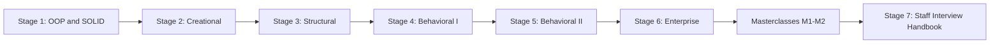

| Stage | Focus Domain | Core Concepts & Engineering Outcomes |
| :--- | :--- | :--- |
| **Stage 1** | **OOP Foundations & SOLID** | Coupling vs cohesion, composition over inheritance, SRP/OCP/LSP/ISP/DIP with Java interfaces and records, Law of Demeter, reading `classDiagram`s. Outcome: refactor a god class into `OrderProcessor` with three injected ports and test it with lambdas. |
| **Stage 2** | **Creational Patterns** | Enum and holder-idiom singletons, static factories over a `sealed` interface, Factory Method, Abstract Factory, validating Builder for an immutable `record`, Prototype through copy constructors instead of `Cloneable`. Outcome: decide when a pattern beats plain DI. |
| **Stage 3** | **Structural Patterns** | Object adapter over a legacy XML API, stackable decorators (cache, log, retry), protection proxy and `java.lang.reflect.Proxy`, Facade, Composite with `sealed` nodes, Flyweight, Bridge. Outcome: wrap third-party code without leaking it. |
| **Stage 4** | **Behavioral: Events, State & Strategy** | Observer with unsubscribe handles, Strategy as `@FunctionalInterface`, Command with undo stacks, State machines for document workflows. |
| **Stage 5** | **Behavioral: Workflow & Traversal** | Chain of Responsibility (middleware), Mediator, Visitor and double dispatch, and their modern `switch`-based alternatives. |
| **Stage 6** | **Enterprise Architecture** | Repository and Unit of Work, CQRS and Event Sourcing, the Outbox pattern, ports and adapters. |
| **Masterclasses** | **DI container internals, anti-patterns and refactoring** | Build a type-keyed container with lifetimes and cycle detection; turn type switches and god objects into patterns step by step. |
| **Stage 7** | **Staff Interview Handbook** | Interview Q&As from definitions to scenario debugging, a pattern selection decision tree and a dense cheatsheet. |

---

## 🆕 Design Patterns Versions, What's New & Migration

Patterns do not have version numbers, but the language you write them in does. Each Java release since 8 has made some classic pattern boilerplate unnecessary. This section tracks the releases that changed how patterns look in Java code.

### V.1 Release Timeline

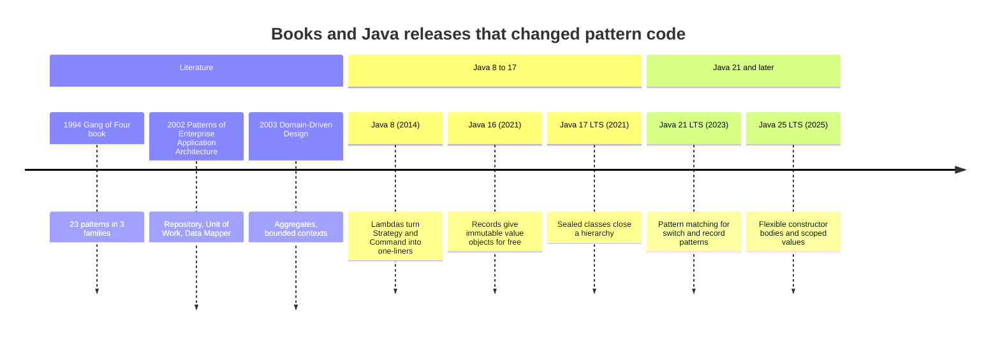

### V.2 Compatibility Matrix

| Java | Released | Release type | Features that change pattern code | Starter project |
| --- | --- | --- | --- | --- |
| 8 | March 2014 | LTS | Lambdas, functional interfaces, default methods, streams | Does not compile (needs records, sealed types, `switch` patterns) |
| 11 | September 2018 | LTS | `var` (from 10), `List.of`/`Map.of` factories (from 9) | Does not compile |
| 17 | September 2021 | LTS | Records (16), sealed classes, `instanceof` patterns (16), switch expressions (14) | Does not compile (`List.getFirst`, virtual threads) |
| 21 | September 2023 | LTS | Pattern matching for `switch`, record patterns, virtual threads, sequenced collections | Target version: CI, Dockerfile and Gradle toolchain |
| 25 | September 2025 | LTS | Flexible constructor bodies, scoped values, compact source files, module imports | The built jar runs unchanged on a 25 runtime; V.3 snippets need JDK 25 |
| 26+ | March 2026 onward | Feature releases | Six-monthly; check each release's JEP list | Expected to run unchanged |

Tooling used by the starter: Gradle 9 (the wrapper pins the exact version; Gradle 9 itself needs JDK 17+ to run), JUnit 5.13, Eclipse Temurin images.

### V.3 What's New in Java 25 for Pattern Code

The starter stays on Java 21 so it builds on the widest range of machines. The snippets below need JDK 25.

#### Flexible constructor bodies (JEP 513)

Before Java 25 a constructor had to call `super(...)` or `this(...)` first, so validation of arguments for the superclass had to hide in a static helper. Now statements that do not touch `this` may run first. This makes Template Method base classes and Builder-backed constructors simpler.

```java
// Java 21: validation squeezed into a static method call inside super(...)
public final class UrgentAlert extends Alert {
    public UrgentAlert(MessageSender sender) {
        super(requireNotNoop(sender));
    }

    private static MessageSender requireNotNoop(MessageSender sender) {
        if (sender == null) throw new IllegalArgumentException("sender required");
        return sender;
    }
}
```

```java
// Java 25: validate first, then delegate
public final class UrgentAlert extends Alert {
    public UrgentAlert(MessageSender sender) {
        if (sender == null) throw new IllegalArgumentException("sender required");
        super(sender);
    }
}
```

#### Scoped values (JEP 506)

A scoped value is an immutable, per-call binding that child code can read and that disappears when the call ends. It replaces many uses of `ThreadLocal` and of "ambient context" singletons such as a static `CurrentUser`. It is the clean way to give a Protection Proxy (Stage 3) the caller's roles.

```java
// Before: a ThreadLocal must be set and, crucially, cleared by hand
static final ThreadLocal<Set<String>> ROLES = new ThreadLocal<>();

void handle(Request request) {
    ROLES.set(request.roles());
    try {
        store.delete(request.documentId());
    } finally {
        ROLES.remove(); // forget this and the next request on the pooled thread inherits the roles
    }
}
```

```java
// Java 25: the binding exists only inside run(...)
static final ScopedValue<Set<String>> ROLES = ScopedValue.newInstance();

void handle(Request request) {
    ScopedValue.where(ROLES, request.roles()).run(() -> store.delete(request.documentId()));
}

// The proxy reads it with ROLES.get(); outside a binding, ROLES.isBound() is false.
```

#### Compact source files and instance `main` (JEP 512)

A single file with a bare `void main()` now runs with `java Demo.java`, and `java.lang.IO` offers `IO.println`. Handy for trying one pattern in isolation without a project:

```java
// Demo.java, run with: java Demo.java
record Glyph(char symbol) {}

void main() {
    var pool = new java.util.HashMap<Character, Glyph>();
    for (char c : "banana".toCharArray()) {
        pool.computeIfAbsent(c, Glyph::new);
    }
    IO.println("distinct glyphs: " + pool.size()); // 3
}
```

#### Module import declarations (JEP 511)

`import module java.base;` imports every exported package of a module. Useful in demos and scripts; in production code explicit imports stay clearer, so the starter does not use it.

### V.4 Migration Guide (Java 8/11/17 pattern code → Java 21)

1. Raise the toolchain and compile with warnings as errors, so deprecated APIs surface immediately.

```kotlin
// build.gradle.kts
java {
    toolchain {
        languageVersion = JavaLanguageVersion.of(21)
    }
}
tasks.withType<JavaCompile>().configureEach {
    options.compilerArgs.addAll(listOf("-Xlint:all", "-Werror"))
}
```

2. Let OpenRewrite do the mechanical part. Use the current stable versions of the plugin and recipe module.

```kotlin
// build.gradle.kts
plugins {
    id("org.openrewrite.rewrite") version "<current stable>"
}
dependencies {
    rewrite("org.openrewrite.recipe:rewrite-migrate-java:<current stable>")
}
rewrite {
    activeRecipe("org.openrewrite.java.migrate.UpgradeToJava21")
}
```

```bash
./gradlew rewriteDryRun   # writes a patch to build/reports/rewrite/ for review
./gradlew rewriteRun      # applies it
./gradlew build           # compile, lint and test on the new release
```

3. Then apply the pattern-level refactors by hand. They change design, so a tool should not guess them:

| Old idiom | Java 21 replacement | Where in this guide |
| --- | --- | --- |
| Anonymous class implementing a one-method Strategy or Command | Lambda or method reference against a `@FunctionalInterface` | [2.3](#23-static-factories-and-factory-method), Stage 4 |
| Value object with hand-written `equals`/`hashCode`/getters | `record` with a compact constructor for validation | [2.5](#25-builder) |
| Visitor over a closed hierarchy | `sealed` interface plus exhaustive `switch` with record patterns | Stage 5 |
| `implements Cloneable` and `super.clone()` | Copy constructor or static `copyOf` | [2.6](#26-prototype) |
| Double-checked locking singleton | Enum singleton, holder idiom, or a DI-managed instance | [2.2](#22-singleton) |
| `java.util.Observable` | Own listener interface, `PropertyChangeSupport`, or `java.util.concurrent.Flow` | Stage 4 |

### V.5 Deprecations & Breaking Changes

| Version | Deprecated / removed | Replacement | What breaks and how to fix it |
| --- | --- | --- | --- |
| 9 | `java.util.Observer` and `java.util.Observable` deprecated | A typed listener interface (see `EventBus` in the starter) or `Flow.Subscriber` | Compiles with deprecation warnings; with `-Werror` the build fails. The old API is untyped (`Object arg`) and forces inheritance from `Observable`. |
| 9, for removal since 16 | Boxed primitive constructors such as `new Integer(5)` | `Integer.valueOf(5)`, which uses a Flyweight cache for -128..127 | Removal warnings; identity comparisons on boxed values were never reliable. |
| 9, for removal since 18 (JEP 421) | `Object.finalize()` | `try`-with-resources, `java.lang.ref.Cleaner` | Pooled-resource and proxy code that relied on finalizers to release handles must release them explicitly. |
| 17 (JEP 411), disabled in 24 (JEP 486) | Security Manager | Application-level authorization, for example a Protection Proxy | Code that let the Security Manager guard sensitive calls gets no protection; enforce roles in your own proxy or service layer. |
| 21 (JEP 451) | Loading agents into a running JVM prints a warning | Declare agents at startup with `-javaagent`, or opt in with `-XX:+EnableDynamicAgentLoading` | Test suites using inline mock makers or runtime bytecode proxies print warnings; a future release disallows it by default. |
| Never deprecated, discouraged | `Cloneable` / `Object.clone()` | Copy constructors, static factories, records | `clone()` is shallow, skips constructors and needs a cast; see [2.6](#26-prototype). |

---

## 📋 Table of Contents

- [🆕 Design Patterns Versions, What's New & Migration](#-design-patterns-versions-whats-new--migration)
- [1. Stage 1: OOP Foundations & the SOLID Principles](#1-stage-1-oop-foundations--the-solid-principles)
  - [1.1 What a Design Pattern Is (and Is Not)](#11-what-a-design-pattern-is-and-is-not)
  - [1.2 Running the Starter Project](#12-running-the-starter-project)
  - [1.3 Coupling and Cohesion](#13-coupling-and-cohesion)
  - [1.4 Composition Over Inheritance](#14-composition-over-inheritance)
  - [1.5 The SOLID Principles](#15-the-solid-principles)
  - [1.6 Line-by-Line: Refactoring a God Class to SOLID](#16-line-by-line-refactoring-a-god-class-to-solid)
  - [1.7 The Law of Demeter (Tell, Don't Ask)](#17-the-law-of-demeter-tell-dont-ask)
  - [1.8 Reading Class Diagrams](#18-reading-class-diagrams)
  - [1.9 Pitfalls](#19-pitfalls)
  - [1.10 Best Practices](#110-best-practices)
  - [1.11 Hands-on Exercise](#111-hands-on-exercise)
- [2. Stage 2: Creational Patterns](#2-stage-2-creational-patterns)
  - [2.1 Why Creation Needs Patterns](#21-why-creation-needs-patterns)
  - [2.2 Singleton](#22-singleton)
  - [2.3 Static Factories and Factory Method](#23-static-factories-and-factory-method)
  - [2.4 Abstract Factory](#24-abstract-factory)
  - [2.5 Builder](#25-builder)
  - [2.6 Prototype](#26-prototype)
  - [2.7 Choosing a Creational Pattern (and When to Use DI Instead)](#27-choosing-a-creational-pattern-and-when-to-use-di-instead)
  - [2.8 Pitfalls](#28-pitfalls)
  - [2.9 Best Practices](#29-best-practices)
  - [2.10 Hands-on Exercise](#210-hands-on-exercise)
- [3. Stage 3: Structural Patterns](#3-stage-3-structural-patterns)
  - [3.1 Wrapping, Delegation and the Structural Family](#31-wrapping-delegation-and-the-structural-family)
  - [3.2 Adapter](#32-adapter)
  - [3.3 Decorator](#33-decorator)
  - [3.4 Proxy](#34-proxy)
  - [3.5 Facade](#35-facade)
  - [3.6 Composite](#36-composite)
  - [3.7 Flyweight](#37-flyweight)
  - [3.8 Bridge](#38-bridge)
  - [3.9 Adapter vs Decorator vs Proxy vs Facade](#39-adapter-vs-decorator-vs-proxy-vs-facade)
  - [3.10 Pitfalls](#310-pitfalls)
  - [3.11 Best Practices](#311-best-practices)
  - [3.12 Hands-on Exercise](#312-hands-on-exercise)
- [4. Stage 4: Behavioral Patterns: Events, State & Strategy](#4-stage-4-behavioral-patterns-events-state--strategy)
  - [4.1 Observer Pattern & Event-Driven Decoupling](#41-observer-pattern--event-driven-decoupling)
  - [4.2 Strategy Pattern (Pluggable Algorithms)](#42-strategy-pattern-pluggable-algorithms)
  - [4.3 Command Pattern (Undo/Redo Stacks)](#43-command-pattern-undoredo-stacks)
  - [4.4 State Pattern: Document Workflow Engine](#44-state-pattern-document-workflow-engine)
- [5. Stage 5: Behavioral Patterns: Workflow & Traversal](#5-stage-5-behavioral-patterns-workflow--traversal)
  - [5.1 Chain of Responsibility (Middleware Pipelines)](#51-chain-of-responsibility-middleware-pipelines)
  - [5.2 Mediator Pattern](#52-mediator-pattern)
  - [5.3 Visitor Pattern & Double Dispatch: Expression Evaluator](#53-visitor-pattern--double-dispatch-expression-evaluator)
- [6. Stage 6: Enterprise Architectural Patterns](#6-stage-6-enterprise-architectural-patterns)
  - [6.1 Repository Pattern & Unit of Work](#61-repository-pattern--unit-of-work)
  - [6.2 CQRS & Event Sourcing](#62-cqrs--event-sourcing)
- [M1. Masterclass: Building a Dependency Injection Container](#m1-masterclass-building-a-dependency-injection-container)
  - [M1.1 How a Container Resolves a Graph](#m11-how-a-container-resolves-a-graph)
  - [M1.2 Worked Example](#m12-worked-example)
  - [M1.3 Lifetimes and Trade-offs](#m13-lifetimes-and-trade-offs)
  - [M1.4 Production Checklist](#m14-production-checklist)
- [M2. Masterclass: Anti-Patterns & Refactoring to Patterns](#m2-masterclass-anti-patterns--refactoring-to-patterns)
  - [M2.1 How a Code Smell Becomes an Anti-Pattern](#m21-how-a-code-smell-becomes-an-anti-pattern)
  - [M2.2 Worked Example: Replace a Type Switch with Strategy](#m22-worked-example-replace-a-type-switch-with-strategy)
  - [M2.3 The Six Fatal Anti-Patterns](#m23-the-six-fatal-anti-patterns)
  - [M2.4 Production Checklist](#m24-production-checklist)
- [7. Stage 7: Staff Design Patterns Software Engineer Interview Handbook & Cheatsheet](#7-stage-7-staff-design-patterns-software-engineer-interview-handbook--cheatsheet)
  - [7.1 Core Concepts (Q1-Q10)](#71-core-concepts-q1-q10)
  - [7.2 Internals & Performance (Q11-Q18)](#72-internals--performance-q11-q18)
  - [7.3 Architecture & Design (Q19-Q25)](#73-architecture--design-q19-q25)
  - [7.4 Scenario & Debugging Questions (Q26-Q28)](#74-scenario--debugging-questions-q26-q28)
  - [7.5 Staff Cheatsheet](#75-staff-cheatsheet)
  - [7.6 Pattern Selection Decision Framework](#76-pattern-selection-decision-framework)
- [🧪 Example Projects](#-example-projects)
- [📝 Cheat Sheets](#-cheat-sheets)
- [📚 Resources](#-resources)
- [🤝 Contributing](#-contributing)
- [📄 License](#-license)
- [🙏 Acknowledgments](#-acknowledgments)
- [🌐 Connect with me](#-connect-with-me)
- [☕ Support](#-support)

---

## 1. Stage 1: OOP Foundations & the SOLID Principles

Patterns are recurring answers to recurring design forces, and those forces are coupling, cohesion and change. This stage gives you the vocabulary (SOLID, composition, Law of Demeter, class diagrams) and the starter project you will extend in every later stage. You need basic Java: classes, interfaces and generics. At the end you can take a class that does everything and split it into small, testable collaborators.

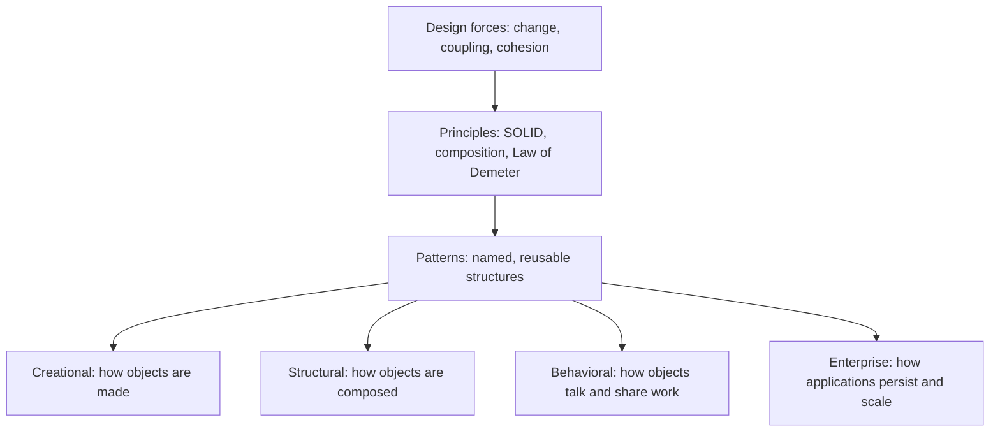

### 1.1 What a Design Pattern Is (and Is Not)

A design pattern is a named description of a problem that keeps coming up, the forces that make it hard, a structure that resolves those forces, and the consequences of using that structure. The 1994 book by Gamma, Helm, Johnson and Vlissides (the "Gang of Four", GoF) catalogued 23 of them for object-oriented code. Later catalogues added enterprise patterns (Fowler, 2002) and domain-driven design building blocks (Evans, 2003).

A pattern is not a library and not a piece of code you copy. Two correct Strategy implementations can look nothing alike: one is a class hierarchy, the other is a `Function<Money, Money>`. What stays constant is the intent ("swap the algorithm at runtime without the caller changing") and the roles (context, strategy).

Each pattern in this guide is described with the same anatomy:

| Part | Question it answers | Example (Adapter) |
| --- | --- | --- |
| Intent | What does it achieve, in one sentence? | Make an existing class usable through an interface it does not implement. |
| Forces | What makes the problem hard? | The vendor class cannot be edited; callers must not depend on it. |
| Structure | Which roles exist and how do they relate? | Target interface, Adaptee, Adapter that implements Target and holds Adaptee. |
| Consequences | What do you gain and pay? | Callers are isolated from the vendor; one more class to maintain; translation bugs hide in one place. |
| Known uses | Where does it appear in real systems? | `java.io.InputStreamReader` adapts a byte stream to a character `Reader`. |

The GoF families:

| Family | Concern | Patterns (stage) |
| --- | --- | --- |
| Creational | Who creates an object, when, and which concrete class | Singleton, Factory Method, Abstract Factory, Builder, Prototype (Stage 2) |
| Structural | How classes and objects are combined into larger structures | Adapter, Bridge, Composite, Decorator, Facade, Flyweight, Proxy (Stage 3) |
| Behavioral | How responsibilities and communication are assigned | Chain of Responsibility, Command, Interpreter, Iterator, Mediator, Memento, Observer, State, Strategy, Template Method, Visitor (Stages 4-5) |

Patterns are a cost as well as a benefit. Each one adds indirection. Apply a pattern when the force it resolves is present now (a second payment provider exists, a third is planned), not because it might appear one day.

### 1.2 Running the Starter Project

The repository root is a small Java 21 HTTP service. It uses only the JDK (`com.sun.net.httpserver`), so there is nothing to learn about a framework before you learn the patterns. Each package maps to a stage:

```text
src/main/java/org/thelearninghub/patterns/
  App.java                 composition root: picks concrete classes, starts the server
  solid/                   Stage 1: Money, OrderProcessor and its three ports
  creational/              Stage 2: MetricsRegistry, LazyConfig, HttpRequest.Builder, Notification, UiKit, ...
  structural/              Stage 3: adapter, decorators, proxies, facade, composite, flyweight, bridge
  behavioral/              Stage 4-5 preview: DiscountStrategy, EventBus, MiddlewareChain
  enterprise/              M1: Container (dependency injection)
  catalog/, web/           pattern catalog served as JSON, router and JSON writer
src/test/java/...          JUnit 5 tests, one class per stage
```

Install a JDK 21 or newer (Eclipse Temurin, Oracle, Microsoft, Amazon Corretto or any OpenJDK build), then:

```bash
git clone https://github.com/TheLearningHubOrg/learn-design-patterns.git
cd learn-design-patterns

./gradlew build          # compile with -Xlint:all -Werror, run the tests, build build/libs/app.jar
./gradlew run            # start on port 8080 (set PORT to change it)

curl http://localhost:8080/health
curl "http://localhost:8080/api/patterns?category=structural"
curl "http://localhost:8080/api/checkout?amountCents=10000&tier=vip"
```

On Windows use `gradlew.bat build`. With Docker only:

```bash
docker build -t learn-design-patterns .
docker run --rm -p 8080:8080 learn-design-patterns
```

The checkout call returns:

```json
{"orderId":"ORD-1","net":"80.00","tax":"6.40","total":"86.40","paid":true,"reference":"LEG-1"}
```

That one request runs through seven patterns: a Chain of Responsibility (the router's middleware), an enum Singleton (request metrics), a Facade (`CheckoutFacade`), a Strategy (the VIP discount), the SOLID `OrderProcessor`, an Adapter (`LegacyPaymentAdapter`) and the legacy service it wraps.

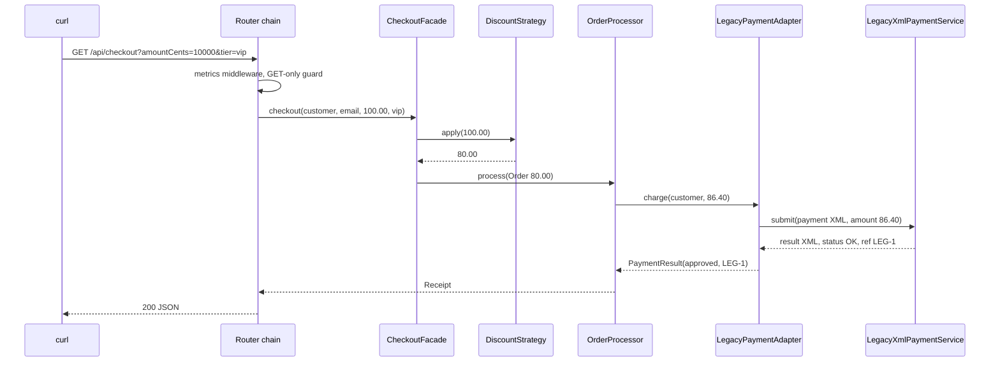

### 1.3 Coupling and Cohesion

Every structural decision trades two forces:

- **Cohesion** is how closely the parts of one module belong together. A class with high cohesion has one job and its methods all use the same fields.
- **Coupling** is how much one module knows about another. With low coupling, changing class A does not force a change in class B.

You want high cohesion and low coupling. A god class has the opposite: unrelated responsibilities (low cohesion) wired directly to concrete infrastructure (high coupling).

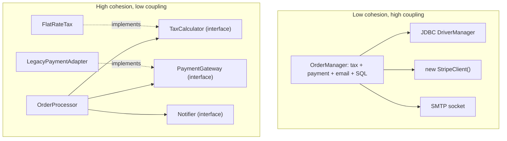

Kinds of coupling, from loosest to tightest:

| Coupling | Example | Why it hurts when tight |
| --- | --- | --- |
| Data | `taxOn(Money net)` takes only the value it needs | Rarely hurts; this is the goal |
| Stamp | `taxOn(Order order)` but only reads `order.net()` | Changes to `Order` ripple into tax code that does not care |
| Control | `process(order, boolean sendEmail)` | The caller steers the callee's internal logic; every flag doubles the test matrix |
| External | Both classes parse the same CSV layout | A format change breaks both, and nothing links them in the code |
| Common | Both read and write a static mutable field | Any class can break any other through shared state |
| Content | Class A reads class B's private field via reflection | B cannot change its internals at all |

Measure cohesion informally by asking "if I describe this class, do I use the word *and*?" `OrderProcessor` "calculates the total, charges it and announces the result" sounds like three jobs, but each step is delegated: the class itself only holds the sequence, which is one responsibility.

### 1.4 Composition Over Inheritance

Inheritance (`extends`) is the tightest coupling Java offers. The subclass depends on the parent's fields, its protected methods and the order in which the parent calls its own overridable methods.

- **Fragile base class.** A parent changes `addAll` to call `add` internally, and a subclass that counts additions by overriding both suddenly double-counts.
- **Rigid taxonomies.** `Duck extends Bird` and every bird can `fly()`. Add `RubberDuck` and you override `fly()` to throw, which breaks every caller that trusted the type.
- **One axis only.** Java has single class inheritance. A class cannot extend both `Flying` and `Swimming`.

Composition asks "what can it do?" instead of "what is it?". Behaviour becomes a field, usually an interface injected through the constructor:

```java
import java.util.Objects;

interface FlyBehavior {
    String fly();
}

interface QuackBehavior {
    String quack();
}

final class Duck {
    private final String name;
    private FlyBehavior fly;              // can change at runtime
    private final QuackBehavior quack;

    Duck(String name, FlyBehavior fly, QuackBehavior quack) {
        this.name = name;
        this.fly = Objects.requireNonNull(fly);
        this.quack = Objects.requireNonNull(quack);
    }

    void setFly(FlyBehavior fly) {
        this.fly = Objects.requireNonNull(fly);
    }

    String perform() {
        return name + ": " + fly.fly() + ", " + quack.quack();
    }
}

class DuckDemo {
    public static void main(String[] args) {
        Duck mallard = new Duck("mallard", () -> "flaps wings", () -> "quack");
        Duck rubber = new Duck("rubber duck", () -> "cannot fly", () -> "squeak");
        System.out.println(mallard.perform()); // mallard: flaps wings, quack
        System.out.println(rubber.perform());  // rubber duck: cannot fly, squeak
        rubber.setFly(() -> "thrown across the room");
        System.out.println(rubber.perform());
    }
}
```

| Question | Inheritance | Composition |
| --- | --- | --- |
| When is the behaviour chosen? | Compile time, fixed per class | Construction time or later |
| How many axes of variation? | One (single inheritance) | As many fields as you need |
| What does the child depend on? | Parent's internals and call order | Only the interface it holds |
| Testability | Must construct the whole parent | Pass a lambda or fake |
| When it is still right | Genuine "is-a" with a stable parent designed for extension, such as `abstract class ReportExporter` in Stage 2, or `RuntimeException` subclasses | Everything else |

Rule of thumb: inherit from a class only when its author designed it for inheritance and documented the self-use (which methods call which). Otherwise make your class `final` and compose. Most classes in the starter are `final` or `record`s for this reason.

### 1.5 The SOLID Principles

Robert C. Martin collected these five principles around 2000; Michael Feathers later arranged them into the SOLID acronym. They are heuristics for where to draw class boundaries, not laws.

| Letter | Principle | Core rule | Benefit |
| :---: | :--- | :--- | :--- |
| **S** | Single Responsibility (SRP) | A class should have one reason to change, meaning one actor or stakeholder who asks for changes. | Fixes for one stakeholder cannot break another's feature. |
| **O** | Open/Closed (OCP) | Add behaviour by adding code, not by editing working code. | New features do not risk regressions in tested code. |
| **L** | Liskov Substitution (LSP) | A subtype must honour every promise its supertype makes. | Callers never need `instanceof` checks to stay correct. |
| **I** | Interface Segregation (ISP) | Clients should not depend on methods they do not call. | Small interfaces are easy to implement, fake and evolve. |
| **D** | Dependency Inversion (DIP) | Policy and details both depend on abstractions owned by the policy side. | Business rules survive swapping databases, vendors and frameworks. |

#### SRP: one reason to change

"Reason to change" means a source of change requests. A payroll class that calculates pay (finance's rules), formats a report (HR's layout) and saves to the database (the DBA's schema) has three. When finance changes overtime rules, the risk lands on HR's report too. Split along those lines: `PayCalculator`, `PayReportFormatter`, `PayRepository`.

#### OCP: extend by adding

In the starter, `OrderProcessor` takes a `TaxCalculator`. Supporting a new tax rule means writing a new class; `OrderProcessor` stays untouched. That is exactly the Stage 1 exercise solution, `solid/TieredTax.java`:

```java
package org.thelearninghub.patterns.solid;

public record TieredTax(Money threshold, int percent) implements TaxCalculator {

    @Override
    public Money taxOn(Money net) {
        return net.compareTo(threshold) < 0 ? Money.ZERO : net.percent(percent);
    }
}
```

OCP is achieved by finding the axis of change (tax rules) and putting an interface on it. You cannot be closed against every change; pick the ones that actually happen.

#### LSP: subtypes keep the promises

The classic violation is `Square extends Rectangle`. A rectangle promises that `setWidth` leaves the height alone. A square must keep sides equal, so its `setWidth` also changes the height, and this caller breaks:

```java
class Rectangle {
    protected long width;
    protected long height;

    void setWidth(long w) { width = w; }
    void setHeight(long h) { height = h; }
    long area() { return width * height; }
}

class Square extends Rectangle {
    @Override void setWidth(long w) { width = w; height = w; }
    @Override void setHeight(long h) { width = h; height = h; }
}

class LspDemo {
    static long stretch(Rectangle r) {
        r.setWidth(5);
        r.setHeight(10);
        return r.area(); // the caller expects 50
    }

    public static void main(String[] args) {
        System.out.println(stretch(new Rectangle())); // 50
        System.out.println(stretch(new Square()));    // 100: the promise is broken
    }
}
```

The fix is to drop the inheritance and the mutators. The starter's `solid/Shape.java` makes both shapes immutable records under a sealed interface; "resizing" returns a new value, so no promise about the old one can be broken:

```java
package org.thelearninghub.patterns.solid;

public sealed interface Shape permits Shape.Rectangle, Shape.Square {

    long area();

    record Rectangle(long width, long height) implements Shape {
        @Override
        public long area() {
            return width * height;
        }

        public Rectangle withWidth(long newWidth) {
            return new Rectangle(newWidth, height);
        }
    }

    record Square(long side) implements Shape {
        @Override
        public long area() {
            return side * side;
        }
    }
}
```

LSP covers more than shapes. A subtype must not strengthen preconditions (reject inputs the parent accepts), weaken postconditions (return less than the parent promises) or throw new checked failures. `Collections.unmodifiableList` returning a `List` whose `add` throws `UnsupportedOperationException` is a famous, deliberate LSP compromise in the JDK.

#### ISP: small interfaces

A fat interface forces implementers to write stubs that throw:

```java
// Violation: a read-only report store is forced to implement writes
interface Repository<T> {
    T find(String id);
    java.util.List<T> findAll();
    void save(T item);
    void delete(String id);
}

final class ArchivedReports implements Repository<String> {
    public String find(String id) { return "report " + id; }
    public java.util.List<String> findAll() { return java.util.List.of(); }
    public void save(String item) { throw new UnsupportedOperationException("archive is read-only"); }
    public void delete(String id) { throw new UnsupportedOperationException("archive is read-only"); }
}
```

Split by client need. Readers depend on `Reader<T>`, writers on `Writer<T>`, and a full store implements both:

```java
interface Reader<T> {
    T find(String id);
}

interface Writer<T> {
    void save(String id, T item);
}

final class ArchivedReports implements Reader<String> {
    public String find(String id) { return "report " + id; }
}
```

The starter's ports are deliberately one method each (`TaxCalculator`, `PaymentGateway`, `Notifier`), which is why tests can pass a lambda.

#### DIP: policy owns the abstraction

"Depend on abstractions" is half of DIP. The other half is *who owns* the abstraction. `PaymentGateway` lives in the `solid` package next to `OrderProcessor`, and it is shaped by what the processor needs (`charge(customerId, amount)`), not by what a vendor SDK offers. The legacy XML adapter in `structural` depends on it, so the source-code dependency points from details to policy, against the flow of control. This is the base of Hexagonal (ports and adapters) and Clean Architecture.

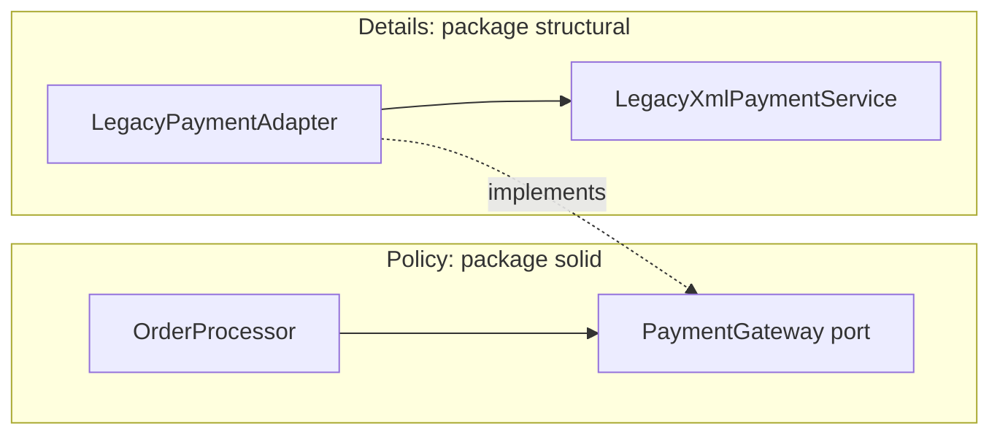

### 1.6 Line-by-Line: Refactoring a God Class to SOLID

Here is the "before": one method that computes tax, charges a hard-wired vendor and sends mail.

```java
import java.math.BigDecimal;

// BEFORE: violates SRP (three jobs), OCP (new tax rule = edit this method)
// and DIP (constructs its own vendor client and mail sender).
final class BadOrderProcessor {
    void process(String orderId, String email, double amount) {
        double tax = amount * 0.1;                       // floating-point money
        StripeClient stripe = new StripeClient("sk_live_hardcoded");
        stripe.charge(amount + tax);                     // cannot be faked in a test
        SmtpMailer.send(email, "Order " + orderId + " confirmed");
    }
}

// Stand-ins so the snippet compiles on its own.
final class StripeClient {
    StripeClient(String key) { }
    void charge(double amount) { }
}

final class SmtpMailer {
    static void send(String to, String body) { }
}
```

And the "after", `solid/OrderProcessor.java` from the starter:

```java
package org.thelearninghub.patterns.solid;

import java.util.Objects;

public final class OrderProcessor {

    private final TaxCalculator tax;
    private final PaymentGateway payments;
    private final Notifier notifier;

    public OrderProcessor(TaxCalculator tax, PaymentGateway payments, Notifier notifier) {
        this.tax = Objects.requireNonNull(tax, "tax");
        this.payments = Objects.requireNonNull(payments, "payments");
        this.notifier = Objects.requireNonNull(notifier, "notifier");
    }

    public Receipt process(Order order) {
        Money taxAmount = tax.taxOn(order.net());
        Money total = order.net().plus(taxAmount);
        PaymentResult result = payments.charge(order.customerId(), total);
        if (result.approved()) {
            notifier.send(order.email(), "Order " + order.id() + " confirmed: " + total);
        }
        return new Receipt(order.id(), order.net(), taxAmount, total, result.approved(), result.reference());
    }
}
```

| Line / API | Role | What happens at runtime |
| :--- | :--- | :--- |
| `public final class` | Closes the class to inheritance | Nobody can override `process` and skip the notification rule; extension happens through the three interfaces instead. |
| `private final` fields | Immutable wiring | Set once in the constructor; safe to share the processor across threads because it holds no mutable state of its own. |
| `Objects.requireNonNull(tax, "tax")` | Fail fast | A missing dependency throws `NullPointerException: tax` at wiring time, not deep inside the first order. |
| `tax.taxOn(order.net())` | Data coupling | The tax rule sees only the amount, not the whole order, so it cannot grow hidden dependencies on order fields. |
| `Money` | Value object | Amounts are whole cents in a `long`; `plus` uses `Math.addExact`, so an overflow throws instead of wrapping. |
| `payments.charge(...)` | DIP port | Calls whatever was injected: the legacy adapter in production, a lambda in tests. |
| `if (result.approved())` | Business rule | The only decision the processor owns: notify on success only. |
| `return new Receipt(...)` | Result as a value | The caller gets everything it needs without calling back into the processor. |

The test shows the payoff. No mocking library, no network: each port is a lambda.

```java
@Test
void processorChargesTaxAndNotifiesOnlyWhenPaid() {
    OrderProcessor processor = new OrderProcessor(
            new FlatRateTax(10),
            (customer, amount) -> PaymentResult.approved("PAY-1"),
            (to, message) -> sent.add(to + "|" + message));

    Receipt receipt = processor.process(new Order("o-1", "c-1", "a@example.com", Money.ofCents(10_000)));

    assertEquals(Money.ofCents(1_000), receipt.tax());
    assertEquals(Money.ofCents(11_000), receipt.total());
    assertTrue(receipt.paid());
    assertEquals(List.of("a@example.com|Order o-1 confirmed: 110.00"), sent);
}
```

Why `Money` instead of `double`: `0.1 + 0.2` is `0.30000000000000004` in binary floating point, and tax rules are written in decimal. Storing cents in a `long` (or using `BigDecimal` with an explicit `RoundingMode`) keeps the arithmetic exact, and `Money.percent` puts the single rounding rule (half up) in one place:

```java
public Money percent(int percent) {
    if (percent < 0) {
        throw new IllegalArgumentException("percent must be >= 0, was " + percent);
    }
    return new Money((Math.multiplyExact(cents, percent) + 50) / 100);
}
```

### 1.7 The Law of Demeter (Tell, Don't Ask)

The Law of Demeter, or principle of least knowledge, says a method should call methods only on: itself, its parameters, objects it creates, and its own fields. Not on objects returned by those calls.

```java
// Violation: the caller navigates three objects deep
String zip = order.getCustomer().getAddress().getZipCode();
```

Every dot is a dependency. If `Customer` later holds several addresses, every caller that walked the chain breaks. Move the question to the object that has the data:

```java
record Address(String street, String zipCode) {}

record Customer(String name, Address shippingAddress) {
    String shippingZip() {
        return shippingAddress.zipCode();
    }
}

record DemeterOrder(String id, Customer customer) {
    String deliveryZip() {
        return customer.shippingZip(); // talks only to its own field
    }
}
```

Callers now write `order.deliveryZip()`. Two clarifications that interviews like to probe:

- Fluent APIs (`builder.method("POST").header(...).build()`) and stream pipelines are not violations: each call returns the same kind of object you started with, so you learn nothing new about a stranger's structure.
- Records and other plain data carriers may expose their components. Demeter is about not reaching through behaviour-rich objects to manipulate their internals, not about banning every getter.

"Tell, don't ask" is the behavioural version: instead of asking an object for its state and deciding for it (`if (account.getBalance() > x) account.setBalance(...)`), tell it what you want (`account.withdraw(x)`) and let it enforce its own rules.

### 1.8 Reading Class Diagrams

The rest of the guide draws pattern structures as Mermaid `classDiagram`s, which follow UML notation:

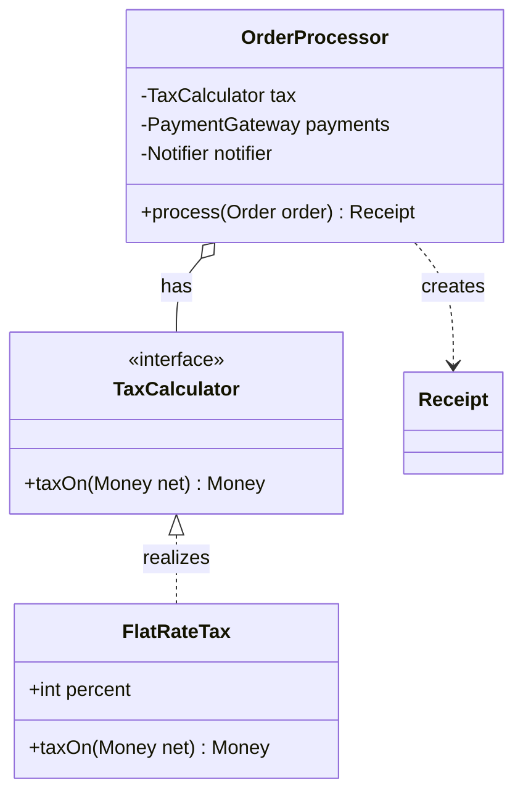

| Notation | Meaning | Java |
| --- | --- | --- |
| `A <\|-- B` | Inheritance (B extends A) | `class B extends A` |
| `A <\|.. B` | Realization (B implements A) | `class B implements A` |
| `A *-- B` | Composition: B's lifetime is owned by A | A creates B internally and never shares it |
| `A o-- B` | Aggregation: A holds B, B lives independently | B is injected through A's constructor |
| `A --> B` | Association: A has a reference to B | A field of type B |
| `A ..> B` | Dependency: A uses B briefly | B is a parameter, local or return type |
| `+` / `-` / `#` | public / private / protected | Visibility modifiers |
| `<<interface>>` | Stereotype | `interface` |

### 1.9 Pitfalls

| Pitfall | Symptom | Fix |
| --- | --- | --- |
| Pattern-first design | A `PaymentStrategyFactoryProvider` with one implementation; reviewers cannot find where work happens | Start with the simplest code; introduce the pattern when a second variant or a real test seam appears. |
| Interfaces with exactly one implementation everywhere | Every class has an `IFoo`/`FooImpl` pair; navigation doubles, nothing is ever swapped | Extract an interface at a real boundary (I/O, vendor, policy). Inside a module, a `final` class is fine and still testable. |
| Inheriting for code reuse | Changing a protected helper in the base class breaks a subclass in another module | Move the shared code into a collaborator and inject it. |
| LSP break through an override that throws | `UnsupportedOperationException` from a method the supertype promised | Split the interface (ISP) or stop subclassing. |
| SRP taken to one method per class | Dozens of `XxxDoer` classes, each called once | SRP is about reasons to change, not size. Group code that changes together. |
| `double` for money | `assertEquals(0.3, 0.1 + 0.2)` fails with `expected: <0.3> but was: <0.30000000000000004>` | Use cents in a `long` or `BigDecimal` with an explicit `RoundingMode`. |
| Train-wreck navigation | `NullPointerException: Cannot invoke "Address.getZipCode()" because the return value of "Customer.getAddress()" is null` | Tell the owner (`order.deliveryZip()`), so null handling lives in one place. |
| Ports shaped by the vendor | `PaymentGateway.charge(StripeChargeParams)`; a second provider cannot implement it cleanly | Shape the port from the caller's needs and translate in an adapter. |

### 1.10 Best Practices

- **Make classes `final` by default**: extension is then a deliberate design choice, not an accident.
- **Prefer records for values**: immutability removes whole categories of LSP and aliasing bugs.
- **Inject collaborators through the constructor**: dependencies are visible in one place and the object is complete once built.
- **Validate in constructors with `Objects.requireNonNull` and range checks**: bad wiring fails at startup, with a message.
- **Keep ports small and owned by the caller**: one-method interfaces are trivial to fake with a lambda.
- **Name things after the domain, not the pattern**: `CheckoutFacade` is acceptable because the facade role matters to readers; `OrderStrategyImpl` is not.
- **Put all wiring in one composition root (`App.java`)**: the rest of the code never chooses concrete classes.
- **Write the test first for each new rule**: if a rule is hard to test, the coupling is too tight.

### 1.11 Hands-on Exercise

**Task.** Add a tax rule that charges nothing below a threshold and a fixed percentage at or above it, without editing `OrderProcessor`, `FlatRateTax` or any existing test. Then wire it into a test that processes a 9.99 order and a 10.00 order.

**Expected result.** With a threshold of 10.00 and a rate of 10%:

```text
taxOn(9.99)  -> 0.00
taxOn(10.00) -> 1.00
```

`./gradlew test` stays green and `git diff --stat` shows only new files plus your new test.

**Solution.** `src/main/java/org/thelearninghub/patterns/solid/TieredTax.java` and the test `tieredTaxIsANewRuleWithoutTouchingTheProcessor` in `src/test/java/org/thelearninghub/patterns/SolidTest.java`. If your solution needed an `if` inside `OrderProcessor`, revisit [1.5](#15-the-solid-principles): the axis of change is the `TaxCalculator` interface.

[Back to top ⤴️](#-table-of-contents)

---

## 2. Stage 2: Creational Patterns

Creational patterns decide who calls `new`, when, and for which concrete class. This stage covers the five GoF creational patterns in modern Java, plus static factories and the point where a dependency-injection container makes a pattern unnecessary. Prerequisite: Stage 1's DIP. Afterwards you can build immutable objects safely, hide concrete classes behind factories, and explain why most Singletons should be DI-managed instances.

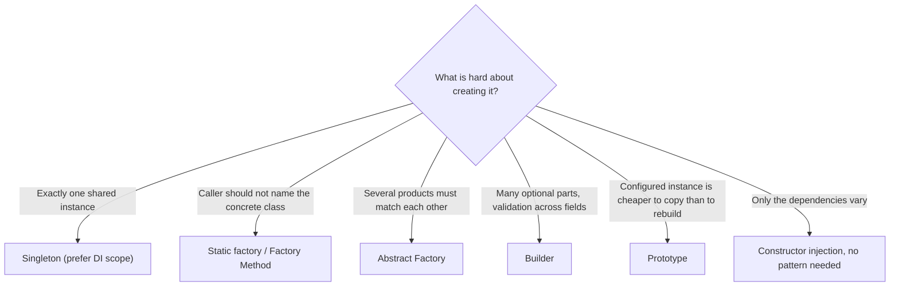

### 2.1 Why Creation Needs Patterns

`new PostgresOrderRepository(...)` written inside a business class is a hard dependency on a concrete class, its constructor signature and everything that constructor needs. Creational patterns move that knowledge to one place. Three questions decide which one fits:

| Question | If the answer is yes | Pattern |
| --- | --- | --- |
| Must the caller stay ignorant of the concrete class? | Return an interface from a method | Static factory, Factory Method |
| Do several created objects have to be compatible with each other? | Create them all from one object | Abstract Factory |
| Is construction multi-step, with optional parts and cross-field rules? | Accumulate state, validate once | Builder |
| Is a configured object the template for many similar ones? | Copy it | Prototype |
| Must there be one instance per process? | Control instantiation | Singleton, or a singleton scope in a DI container |

Java-specific creational tools you will use alongside the patterns:

| Tool | Use |
| --- | --- |
| `record` | Immutable value with a canonical constructor that can validate (compact constructor) |
| Static factory methods (`of`, `from`, `valueOf`, `parse`) | Named constructors that may cache, validate or return a subtype |
| `sealed` interfaces | A closed set of products, so a factory `switch` is checked for exhaustiveness |
| `enum` | The simplest correct singleton, and a natural registry of strategies |
| `ServiceLoader` | Discover implementations on the classpath or module path at runtime (a plug-in factory) |

### 2.2 Singleton

**Intent.** Guarantee one instance of a class in a process and give it a well-known access point.

**Forces.** Some things really are one per process: a metrics registry, a connection pool, the configuration read from the environment. Constructing a second one wastes resources or splits state.

The safest Java form is an enum with one constant. The JVM creates the constant during class initialisation, which the Java Language Specification makes thread-safe, and enums are protected against a second instance through reflection and serialization. The starter's `creational/MetricsRegistry.java`:

```java
package org.thelearninghub.patterns.creational;

import java.util.Map;
import java.util.TreeMap;
import java.util.concurrent.ConcurrentHashMap;
import java.util.concurrent.atomic.LongAdder;

public enum MetricsRegistry {
    INSTANCE;

    private final ConcurrentHashMap<String, LongAdder> counters = new ConcurrentHashMap<>();

    public void increment(String name) {
        counters.computeIfAbsent(name, key -> new LongAdder()).increment();
    }

    public long count(String name) {
        LongAdder adder = counters.get(name);
        return adder == null ? 0 : adder.sum();
    }

    public Map<String, Long> snapshot() {
        Map<String, Long> copy = new TreeMap<>();
        counters.forEach((name, adder) -> copy.put(name, adder.sum()));
        return copy;
    }

    public void reset() {
        counters.clear();
    }
}
```

| Line / API | Role | What happens at runtime |
| :--- | :--- | :--- |
| `enum MetricsRegistry { INSTANCE; }` | The single instance | Created when the enum class is initialised, on first access to `MetricsRegistry`. |
| `ConcurrentHashMap` | Shared state that many threads touch | Reads never lock; `computeIfAbsent` creates each counter exactly once. |
| `LongAdder` | Contended counter | Spreads increments over cells to avoid a CAS hot spot; `sum()` adds them up. Faster than `AtomicLong` when many threads increment. |
| `reset()` | Test hook | Global state survives between tests; without a reset, test order changes results. |

When the instance is expensive and may never be needed, use the **initialization-on-demand holder** idiom (`creational/LazyConfig.java`). The nested class is not initialised until `get()` touches it:

```java
public final class LazyConfig {

    private final Map<String, String> values;

    private LazyConfig(Map<String, String> values) {
        this.values = Map.copyOf(values);
    }

    private static final class Holder {
        private static final LazyConfig INSTANCE = new LazyConfig(System.getenv());
    }

    public static LazyConfig get() {
        return Holder.INSTANCE;
    }

    public static LazyConfig of(Map<String, String> values) { // tests build their own
        return new LazyConfig(values);
    }
}
```

The version you will meet in older code is double-checked locking. It is only correct with `volatile`; without it, another thread can see a non-null reference to an object whose constructor has not finished, because the JIT and CPU may reorder the field write and the constructor's writes.

```java
public final class LegacyPool {
    private static volatile LegacyPool instance; // volatile is not optional

    private LegacyPool() { }

    public static LegacyPool getInstance() {
        LegacyPool local = instance;             // one volatile read on the fast path
        if (local == null) {
            synchronized (LegacyPool.class) {
                local = instance;
                if (local == null) {
                    instance = local = new LegacyPool();
                }
            }
        }
        return local;
    }
}
```

| Variant | Lazy | Thread-safe | Reflection / serialization safe | Verdict |
| --- | --- | --- | --- | --- |
| Enum | No (on class init) | Yes, by the JLS | Yes | Default choice |
| Holder idiom | Yes | Yes, by class-init rules | No (needs extra guards) | Lazy and simple |
| `static final` field | No | Yes | No | Fine for cheap objects |
| Double-checked locking with `volatile` | Yes | Yes | No | Legacy; prefer holder |
| Unsynchronized lazy `if (instance == null)` | Yes | No: two threads can each create one | No | Bug |

**Why the pattern is controversial.** A static `getInstance()` is a hidden dependency: the constructor of a class that calls it does not tell you it needs the registry, and a test cannot substitute a fake. Global mutable state also couples tests to each other. The modern answer separates "one instance" (a lifetime decision) from "global access" (a coupling decision): let the composition root or a DI container create one instance and inject it. Spring beans are singleton-scoped by default for exactly this reason. Keep true language-level singletons for stateless or process-wide infrastructure where substitution never matters.

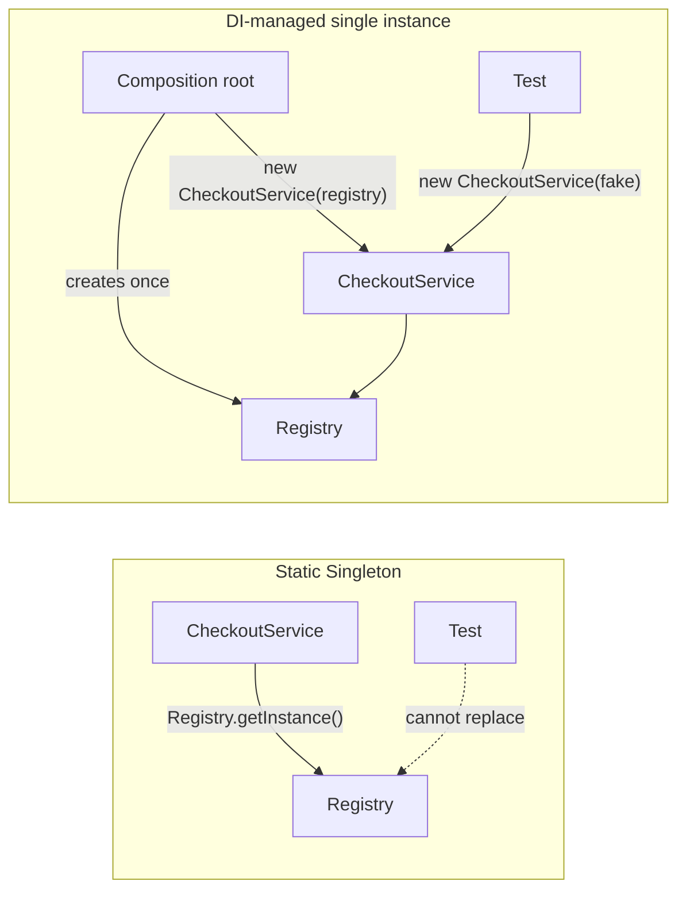

### 2.3 Static Factories and Factory Method

These two are often confused. A **static factory** is a static method that returns an instance, possibly of a subtype. **Factory Method** (the GoF pattern) is an overridable instance method that subclasses implement to choose the product, called from an algorithm in the base class.

#### Static factory over a sealed family

The starter's `creational/Notification.java` lets callers name a channel while the factory picks the concrete record:

```java
public sealed interface Notification permits Notification.Email, Notification.Sms, Notification.Push {

    String recipient();

    String text();

    String deliver();

    enum Channel { EMAIL, SMS, PUSH }

    static Notification of(Channel channel, String recipient, String text) {
        return switch (channel) {
            case EMAIL -> new Email(recipient, text);
            case SMS -> new Sms(recipient, text);
            case PUSH -> new Push(recipient, text);
        };
    }

    record Email(String recipient, String text) implements Notification {
        public Email {
            if (!recipient.contains("@")) {
                throw new IllegalArgumentException("Not an email address: " + recipient);
            }
        }

        @Override
        public String deliver() {
            return "EMAIL to " + recipient + ": " + text;
        }
    }

    // Sms (160-character limit) and Push follow the same shape.
}
```

| Line / API | Role | What happens at runtime |
| :--- | :--- | :--- |
| `sealed ... permits` | Closed product family | Only the three listed records may implement `Notification`. |
| `static Notification of(...)` | Static factory | Callers depend on `Notification` and `Channel`, never on `Email`. |
| `switch (channel)` with no `default` | Exhaustive switch expression | Adding `Channel.SLACK` without a case is a compile error, not a runtime surprise. |
| Compact constructor `public Email { ... }` | Validation in the product | An invalid email throws before the object exists; every `Email` in the system is valid. |

Static factories beat constructors when you want a name (`Duration.ofSeconds`), caching (`Integer.valueOf`), a subtype (`List.of` returns an internal immutable class) or validation that may return an existing instance.

#### Factory Method

Factory Method fits when a base class owns an algorithm and one step of it is "create the right helper". `creational/ReportExporter.java`:

```java
public abstract class ReportExporter {

    public interface RowFormatter {
        String header(List<String> cells);

        String row(List<String> cells);
    }

    protected abstract RowFormatter createFormatter(); // the factory method

    public final String export(List<List<String>> rows) {
        if (rows.isEmpty()) {
            throw new IllegalArgumentException("a report needs at least a header row");
        }
        RowFormatter formatter = createFormatter();
        StringBuilder out = new StringBuilder(formatter.header(rows.getFirst()));
        for (List<String> row : rows.subList(1, rows.size())) {
            out.append(formatter.row(row));
        }
        return out.toString();
    }

    public static final class MarkdownExporter extends ReportExporter {
        @Override
        protected RowFormatter createFormatter() {
            return new RowFormatter() {
                @Override
                public String header(List<String> cells) {
                    return row(cells) + "|" + "---|".repeat(cells.size()) + "\n";
                }

                @Override
                public String row(List<String> cells) {
                    return "| " + String.join(" | ", cells) + " |\n";
                }
            };
        }
    }
}
```

`new ReportExporter.MarkdownExporter().export(rows)` produces a Markdown table; `CsvExporter` produces CSV from the same algorithm. `export` is `final` so subclasses cannot change the algorithm, only the product.

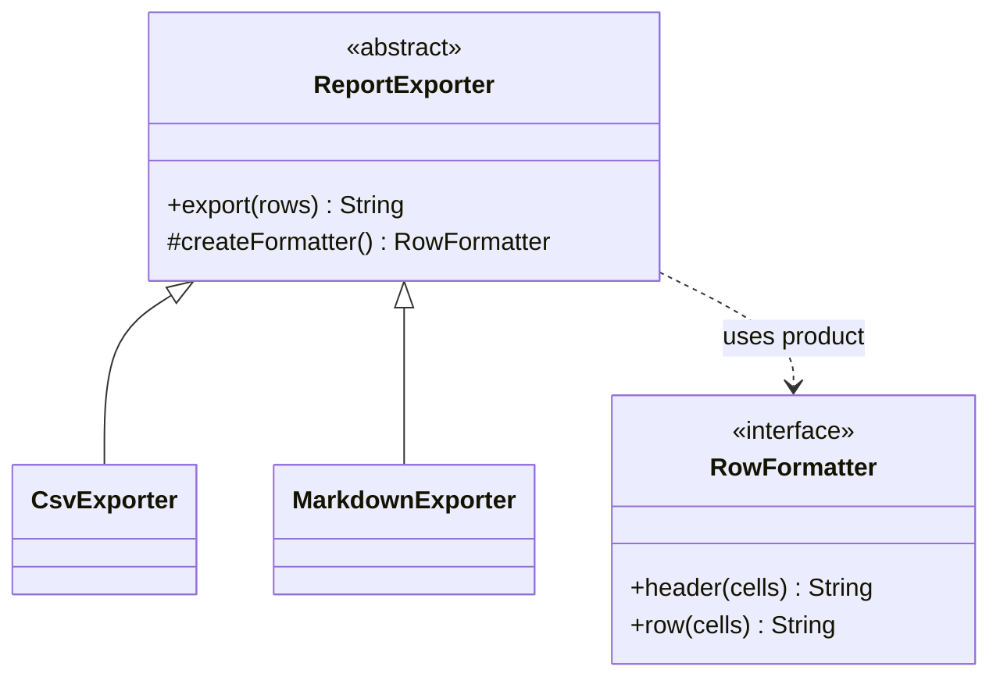

In modern Java the subclass is often replaced by passing a `Supplier<RowFormatter>` to a final class. That is Strategy rather than Factory Method; choose the subclass form when the base class has several hooks that belong together, and the supplier form when only creation varies.

### 2.4 Abstract Factory

**Intent.** Provide one interface for creating a family of related objects, so a client cannot mix products from different families.

**Forces.** A UI theme, a cloud provider (compute, storage and queue clients for the same account), or a database dialect (connection, SQL builder, migration runner) are families: mixing members produces subtle bugs. The client should choose the family once.

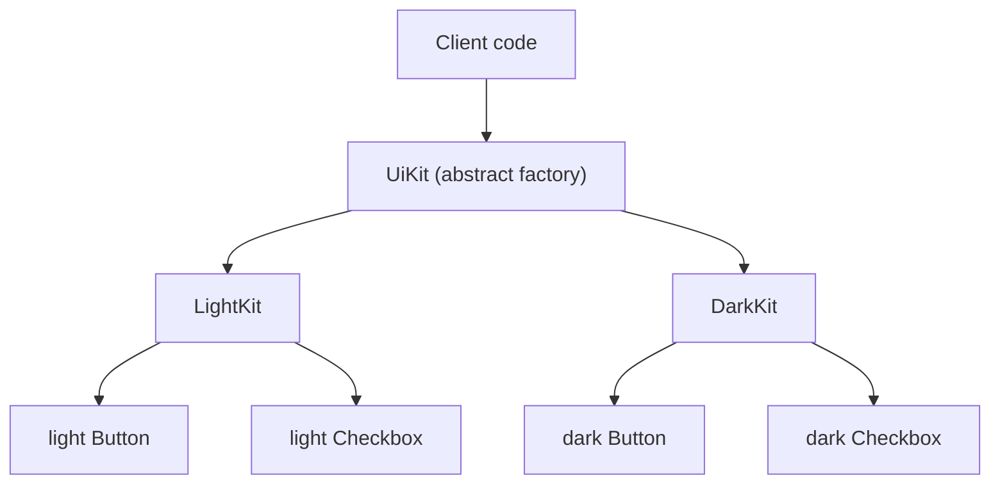

The starter's `creational/UiKit.java`:

```java
public interface UiKit {

    Button button(String label);

    Checkbox checkbox(String label, boolean checked);

    @FunctionalInterface
    interface Button {
        String render();
    }

    @FunctionalInterface
    interface Checkbox {
        String render();
    }

    enum Theme { LIGHT, DARK }

    static UiKit forTheme(Theme theme) {
        return switch (theme) {
            case LIGHT -> new LightKit();
            case DARK -> new DarkKit();
        };
    }

    final class DarkKit implements UiKit {
        @Override
        public Button button(String label) {
            return () -> "<button class=\"btn-dark\">" + label + "</button>";
        }

        @Override
        public Checkbox checkbox(String label, boolean checked) {
            return () -> "<label class=\"chk-dark\">[" + (checked ? "x" : " ") + "] " + label + "</label>";
        }
    }

    // LightKit mirrors DarkKit with the "-light" classes.
}
```

A screen receives a `UiKit` and calls `kit.button("Save")` and `kit.checkbox("Remember me", true)`. It cannot obtain a light checkbox while holding the dark kit.

| | Factory Method | Abstract Factory |
| --- | --- | --- |
| Creates | One product | A family of products |
| Mechanism | Subclass overrides a creation hook | Client holds a factory object |
| Typical trigger | A base-class algorithm needs a variant helper | Products must be consistent with each other |
| Cost of a new product type | One new method in each subclass | One new method on the factory interface and every implementation |
| Cost of a new family | One new subclass | One new factory class |

The last two rows are the trade-off to remember: Abstract Factory makes adding a *family* cheap and adding a *product kind* expensive.

### 2.5 Builder

**Intent.** Separate the step-by-step assembly of a complex object from its final, valid representation.

**Forces.** An object with many optional fields leads to telescoping constructors (`new HttpRequest(url, "POST", headers, body, null, null, 30)`), where nobody can tell which argument is which. JavaBeans setters fix readability but allow half-built, mutable objects. A builder gives named steps, defaults, and one place to validate across fields, then returns an immutable value.

The starter's `creational/HttpRequest.java`:

```java
public record HttpRequest(String method, URI uri, Map<String, String> headers, String body, Duration timeout) {

    public HttpRequest {
        Objects.requireNonNull(method, "method");
        Objects.requireNonNull(uri, "uri");
        headers = Map.copyOf(headers);
        Objects.requireNonNull(body, "body");
        Objects.requireNonNull(timeout, "timeout");
    }

    public static Builder builder(String uri) {
        return new Builder(URI.create(uri));
    }

    public static final class Builder {

        private static final Set<String> METHODS = Set.of("GET", "POST", "PUT", "PATCH", "DELETE");

        private final URI uri;
        private String method = "GET";
        private final Map<String, String> headers = new LinkedHashMap<>();
        private String body = "";
        private Duration timeout = Duration.ofSeconds(5);

        private Builder(URI uri) {
            this.uri = uri;
        }

        public Builder method(String value) {
            String upper = value.toUpperCase(Locale.ROOT);
            if (!METHODS.contains(upper)) {
                throw new IllegalArgumentException("Unsupported method: " + value);
            }
            this.method = upper;
            return this;
        }

        public Builder header(String name, String value) {
            headers.put(name, value);
            return this;
        }

        public Builder body(String value) {
            this.body = Objects.requireNonNull(value, "body");
            return this;
        }

        public Builder timeout(Duration value) {
            if (value.isNegative() || value.isZero()) {
                throw new IllegalArgumentException("timeout must be positive, was " + value);
            }
            this.timeout = value;
            return this;
        }

        public HttpRequest build() {
            if (!body.isEmpty() && (method.equals("GET") || method.equals("DELETE"))) {
                throw new IllegalStateException(method + " requests must not carry a body");
            }
            return new HttpRequest(method, uri, headers, body, timeout);
        }
    }
}
```

```java
HttpRequest request = HttpRequest.builder("https://api.example.com/courses")
        .method("post")
        .header("Content-Type", "application/json")
        .body("{\"title\":\"Patterns\"}")
        .build();
```

| Line / API | Role | What happens at runtime |
| :--- | :--- | :--- |
| `record HttpRequest(...)` | The product | Immutable; `equals`, `hashCode` and accessors generated. |
| `headers = Map.copyOf(headers)` | Defensive copy in the compact constructor | The record never shares the builder's mutable map; `request.headers().put(...)` throws `UnsupportedOperationException`. |
| `private Builder(URI uri)` + `builder(String)` | Required field up front | You cannot start a builder without a URI, so `build()` never has to check for it. |
| Field initialisers (`"GET"`, 5 seconds) | Defaults | Unset options have sensible values. |
| `method(...)` validation | Per-field rule | Fails at the call that is wrong, with the bad value in the message. |
| `return this` | Fluent chaining | Each step returns the same builder. |
| `build()` check | Cross-field rule | Only here are method and body both known. `IllegalStateException` because the builder's state, not one argument, is wrong. |

GoF also describes a **Director**: an object that knows a recipe and drives a builder through it (`ReportDirector.monthlySummary(builder)`). It is useful when the same construction sequence feeds several builders producing different representations, for example the same document steps producing HTML or PDF.

Builder or not:

| Situation | Choose |
| --- | --- |
| Up to about four required fields, no optional ones | Record with a compact constructor |
| A couple of optional fields | Record plus static factories (`of(uri)`, `withTimeout(...)`) |
| Many optional fields or cross-field validation | Builder |
| Construction from external input (JSON, CLI flags) | Builder; the parser calls setters as it reads |

Lombok's `@Builder` generates the mechanical part. It does not write the cross-field `build()` rules, which are the main reason to have a builder.

### 2.6 Prototype

**Intent.** Create new objects by copying a configured instance instead of building from scratch.

**Forces.** Some objects are expensive or tedious to configure (a template with sections and metadata, a game unit with loaded stats, a parsed configuration), and many slight variants are needed. Copying and tweaking beats re-running the setup.

The key decision is copy depth:

- **Shallow copy.** Field values are copied; reference fields point at the same objects. Mutating a shared list through the copy changes the original.
- **Deep copy.** Mutable referenced objects are copied too, recursively, until only immutable values are shared.

Java's built-in `Cloneable`/`Object.clone()` is a poor tool: it is shallow, bypasses constructors (so invariants are not re-checked), returns `Object`, and `Cloneable` declares no methods. The starter uses a copy constructor in `creational/DocumentTemplate.java`:

```java
public final class DocumentTemplate {

    private final String title;
    private final List<String> sections;
    private final Map<String, String> metadata;

    public DocumentTemplate(String title, List<String> sections, Map<String, String> metadata) {
        this.title = title;
        this.sections = new ArrayList<>(sections);       // own container
        this.metadata = new LinkedHashMap<>(metadata);   // own container
    }

    private DocumentTemplate(DocumentTemplate source, String newTitle) {
        this(newTitle, source.sections, source.metadata);
    }

    public DocumentTemplate copy(String newTitle) {
        return new DocumentTemplate(this, newTitle);
    }

    public void addSection(String section) {
        sections.add(section);
    }

    public void tag(String key, String value) {
        metadata.put(key, value);
    }
}
```

The copy is deep enough because the elements are `String`s, which are immutable. If sections were mutable `Section` objects, the copy constructor would have to copy each one (`source.sections.stream().map(Section::copy).toList()`).

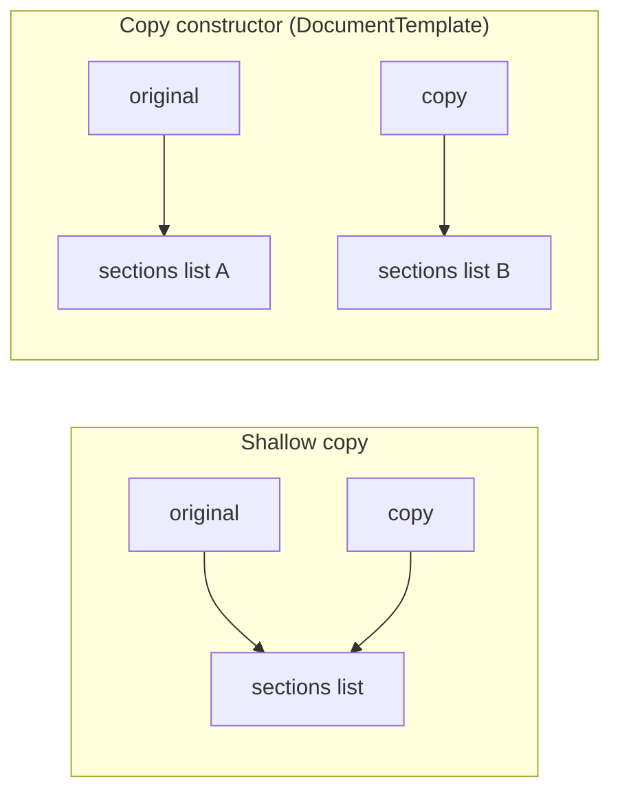

The test proves the independence:

```java
DocumentTemplate base = new DocumentTemplate("RFC", List.of("Context", "Decision"), Map.of("owner", "platform"));
DocumentTemplate copy = base.copy("RFC-42");
copy.addSection("Consequences");
copy.tag("owner", "payments");

assertEquals(List.of("Context", "Decision"), base.sections());   // unchanged
assertEquals("platform", base.metadata().get("owner"));          // unchanged
```

A **prototype registry** stores named, preconfigured instances and hands out copies (`registry.copyOf("rfc")`). With records, much of the pattern disappears: an immutable value can be shared freely, and "copy with one change" is a `with`-style method that calls the canonical constructor (`rectangle.withWidth(6)` in Stage 1).

| Approach | Depth | Re-runs validation | Verdict |
| --- | --- | --- | --- |
| `Object.clone()` | Shallow by default | No | Avoid in new code |
| Copy constructor / `copy()` | You decide per field | Yes | Default |
| Serialization round trip | Deep | Partly | Slow and fragile; avoid |
| Immutable record + `withX` | Not needed: sharing is safe | Yes | Best when the type can be immutable |

### 2.7 Choosing a Creational Pattern (and When to Use DI Instead)

Most "how do I create X?" questions in application code are answered by constructor injection and a composition root, not by a pattern. Patterns earn their place when creation itself has logic.

| Need | First choice | Why not the others |
| --- | --- | --- |
| A service needs a collaborator | Constructor injection | A factory or singleton adds a hidden dependency for no gain. |
| One shared instance of a service | Create it once in the composition root (or DI singleton scope) | A static Singleton blocks substitution in tests. |
| Pick an implementation from data (`"vip"`, `Channel.SMS`) | Static factory over a sealed type or an enum | Abstract Factory is overkill for one product. |
| A family of products must match | Abstract Factory | Separate factories allow mismatches. |
| Many optional parameters, cross-field validation | Builder producing a record | Telescoping constructors are unreadable; setters allow invalid objects. |
| Many variants of a configured object | Prototype via copy constructor, or immutable values | `clone()` is shallow and skips constructors. |
| Implementations discovered at runtime (plug-ins) | `ServiceLoader` | A hand-written registry duplicates what the JDK provides. |

`App.java` is the starter's composition root. It is the only class that picks concrete implementations:

```java
public static HttpServer start(int port) throws IOException {
    CheckoutFacade checkout = CheckoutFacade.withLegacyPayments(
            (recipient, message) -> System.out.printf("notify %s: %s%n", recipient, message));
    Router router = new Router(checkout);

    HttpServer server = HttpServer.create(new InetSocketAddress("0.0.0.0", port), 0);
    server.createContext("/", exchange -> respond(exchange, router));
    server.setExecutor(Executors.newVirtualThreadPerTaskExecutor());
    server.start();
    return server;
}
```

Binding to `0.0.0.0` rather than `localhost` matters in a container: a server bound to the loopback interface inside Docker is unreachable through the published port.

### 2.8 Pitfalls

| Pitfall | Symptom | Fix |
| --- | --- | --- |
| Lazy singleton without synchronization | Two instances created under load; counters split; hard to reproduce | Enum or holder idiom. |
| Double-checked locking without `volatile` | Rare `NullPointerException` or default field values read from a "constructed" instance | Add `volatile`, or switch to the holder idiom. |
| Singleton state leaking between tests | Tests pass alone, fail together: `expected: <1> but was: <3>` | Provide `reset()` and call it in `@AfterEach`, or inject the instance instead. |
| Builder that returns a mutable product | Code mutates the "built" object after validation passed | Build a record; copy collections with `List.copyOf`/`Map.copyOf`. |
| Validation only in setters | `build()` returns a GET with a body | Put cross-field rules in `build()`. |
| `clone()` on an object with mutable fields | Editing the copy's list changes the original | Copy constructor that copies each mutable field. |
| Factory with `default -> null` | `NullPointerException` far from the factory | Exhaustive switch over a sealed type or enum; throw for unknown input. |
| Abstract Factory for a single product | A factory interface, two implementations, one method each | Use a static factory or a `Supplier`. |
| Reflection breaking a holder singleton | `setAccessible(true)` plus `newInstance()` creates a second instance | Use an enum when a second instance must be impossible. |

### 2.9 Best Practices

- **Prefer constructor injection to any creational pattern**: it makes dependencies explicit and needs no extra types.
- **Use an enum when you truly need a language-level singleton**: it is thread-safe and serialization-safe with no code.
- **Give singletons a reset or avoid static access**: tests must be able to start from a clean state.
- **Make built objects immutable records**: validation done once stays valid.
- **Require mandatory fields in the builder's entry point**: `builder(uri)` makes "forgot the URI" impossible.
- **Name static factories by convention (`of`, `from`, `valueOf`, `parse`, `copyOf`)**: readers know what they do without opening them.
- **Seal product hierarchies created by a factory**: the compiler finds every switch that needs a new case.
- **Copy collections at boundaries (`List.copyOf`)**: a caller's later mutation cannot reach into your object.

### 2.10 Hands-on Exercise

**Task.** Add a `timeout` cross-field rule to `HttpRequest.Builder`: a `DELETE` request must have a timeout of at most 10 seconds. Then add a `Channel.WEBHOOK` to `Notification` and observe what the compiler tells you before you add the new record.

**Expected output.** After adding the enum constant, `./gradlew compileJava` fails with an error similar to:

```text
Notification.java: error: the switch expression does not cover all possible input values
        return switch (channel) {
               ^
```

After adding `record Webhook(String recipient, String text) implements Notification` (and listing it in `permits`) plus the switch case, the build is green. A test should assert that `builder(...).method("DELETE").timeout(Duration.ofSeconds(30)).build()` throws `IllegalStateException`.

**Solution.** The existing rules to copy from are in `src/main/java/org/thelearninghub/patterns/creational/HttpRequest.java` (`build()`) and `Notification.java`; the matching tests are `builderAppliesDefaultsAndValidatesAcrossFields` and `staticFactoryPicksTheConcreteType` in `src/test/java/org/thelearninghub/patterns/CreationalTest.java`. The compile error is the lesson: an exhaustive switch over an enum or sealed type turns "forgot a case" into a build failure.

[Back to top ⤴️](#-table-of-contents)

---

## 3. Stage 3: Structural Patterns

Structural patterns combine objects into larger structures while keeping each piece replaceable. Almost all of them work by holding a reference to another object and forwarding calls to it; what differs is the intent. This stage builds on Stage 1's interfaces and Stage 2's factories. At the end you can wrap a legacy API, layer caching and retries onto a service, guard access with a proxy, and pick the right wrapper by intent.

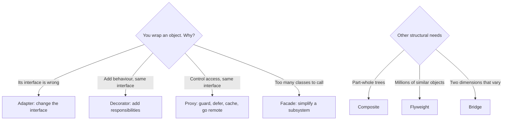

### 3.1 Wrapping, Delegation and the Structural Family

Delegation means an object handles a call by calling another object. It is how composition (Stage 1.4) does the work inheritance would otherwise do. Four of the seven structural patterns are delegation with a specific purpose, and their class diagrams are nearly identical, which is why interviewers ask you to tell them apart.

| Pattern | Interface seen by the client | Wrapped object | Typical count of layers |
| --- | --- | --- | --- |
| Adapter | Different from the wrapped object's | Usually something you cannot change | One |
| Decorator | Same as the wrapped object's | Another implementation of that interface | Many, stacked |
| Proxy | Same as the wrapped object's | The real subject | Usually one |
| Facade | New, simpler, task-oriented | Several subsystem objects | One |
| Composite | Same for leaves and containers | Children of the same interface | A tree |
| Flyweight | A shared object plus caller-supplied context | Pooled instances | Not a wrapper |
| Bridge | Abstraction hierarchy | Implementation hierarchy | Two parallel hierarchies |

### 3.2 Adapter

**Intent.** Convert the interface of an existing class into the interface clients expect.

**Forces.** You have a working class you must not or cannot modify (a vendor SDK, a legacy module, a generated client) and code that expects a different interface. Changing the callers would spread the foreign API everywhere.

The starter adapts a legacy service that speaks XML strings and decimal amounts to the `PaymentGateway` port from Stage 1:

```java
// The adaptee: structural/LegacyXmlPaymentService.java
public final class LegacyXmlPaymentService {

    private static final Pattern AMOUNT = Pattern.compile("amount=\"([0-9]+\\.[0-9]{2})\"");
    private static final BigDecimal LIMIT = new BigDecimal("10000.00");

    private int sequence;

    /** Accepts {@code <payment account="..." amount="12.34" currency="USD"/>}. */
    public synchronized String submit(String xml) {
        Matcher amount = AMOUNT.matcher(xml);
        if (!xml.startsWith("<payment ") || !amount.find()) {
            return "<result status=\"ERROR\" reason=\"malformed\"/>";
        }
        if (new BigDecimal(amount.group(1)).compareTo(LIMIT) > 0) {
            return "<result status=\"DECLINED\" reason=\"over-limit\"/>";
        }
        sequence++;
        return "<result status=\"OK\" ref=\"LEG-" + sequence + "\"/>";
    }
}
```

```java
// The adapter: structural/LegacyPaymentAdapter.java
public final class LegacyPaymentAdapter implements PaymentGateway {

    private static final Pattern STATUS = Pattern.compile("status=\"(\\w+)\"");
    private static final Pattern REF = Pattern.compile("ref=\"([^\"]+)\"");
    private static final Pattern REASON = Pattern.compile("reason=\"([^\"]+)\"");

    private final LegacyXmlPaymentService legacy;

    public LegacyPaymentAdapter(LegacyXmlPaymentService legacy) {
        this.legacy = Objects.requireNonNull(legacy, "legacy");
    }

    @Override
    public PaymentResult charge(String customerId, Money amount) {
        String request = "<payment account=\"" + escape(customerId) + "\" amount=\"" + amount
                + "\" currency=\"USD\"/>";
        String reply = legacy.submit(request);
        String status = find(STATUS, reply).orElse("ERROR");
        if (status.equals("OK")) {
            return PaymentResult.approved(find(REF, reply).orElseThrow());
        }
        return PaymentResult.declined(find(REASON, reply).orElse(status.toLowerCase(Locale.ROOT)));
    }

    private static Optional<String> find(Pattern pattern, String text) {
        Matcher matcher = pattern.matcher(text);
        return matcher.find() ? Optional.of(matcher.group(1)) : Optional.empty();
    }

    private static String escape(String raw) {
        return raw.replace("&", "&amp;").replace("<", "&lt;").replace(">", "&gt;").replace("\"", "&quot;");
    }
}
```

| Line / API | Role | What happens at runtime |
| :--- | :--- | :--- |
| `implements PaymentGateway` | Target interface | `OrderProcessor` cannot tell it is talking to a legacy system. |
| `private final LegacyXmlPaymentService legacy` | Adaptee held by composition | Object adapter: works with any instance, including subclasses or test doubles of the adaptee. |
| `"amount=\"" + amount` | Outbound translation | `Money.toString()` renders cents as `86.40`, the decimal format the legacy API wants. |
| `escape(customerId)` | Protocol safety | A customer id containing `"` cannot inject attributes into the XML. |
| `find(STATUS, reply)` | Inbound translation | Parses the reply into the domain's `PaymentResult`; XML never leaks past this class. |
| `PaymentResult.declined(reason)` | Error mapping | Vendor statuses (`DECLINED`, `ERROR`) become one domain concept with a readable reason. |

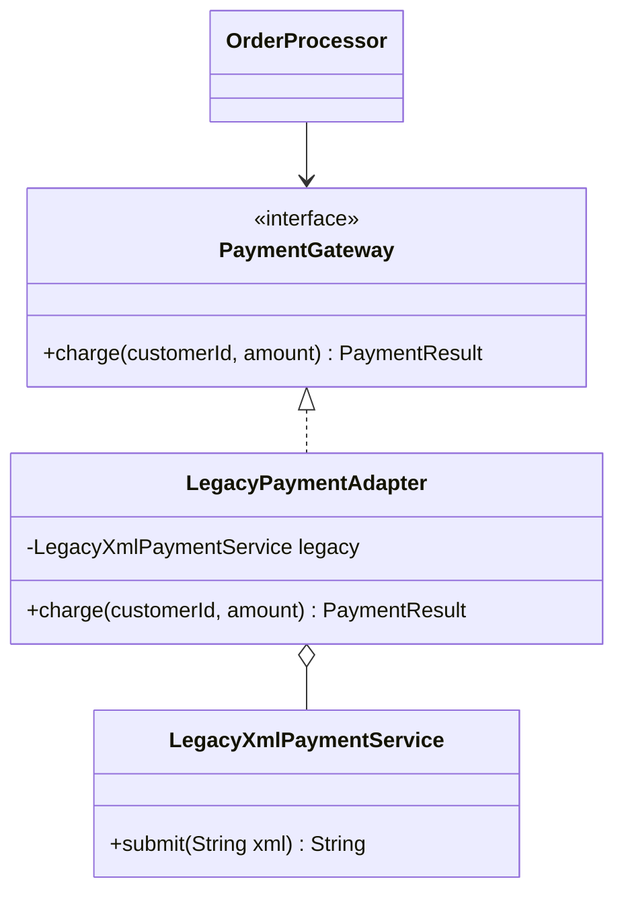

**Object adapter vs class adapter.** A class adapter inherits from the adaptee instead of holding it. Java has no multiple class inheritance, but a class adapter is still possible when the target is an interface: `class XmlGatewayAdapter extends LegacyXmlPaymentService implements PaymentGateway`. It saves one field, but it exposes all of the adaptee's public methods on the adapter, cannot adapt a `final` adaptee (ours is `final`), and cannot wrap an existing instance. Prefer the object adapter.

Known JDK adapters: `InputStreamReader` (bytes to characters), `Arrays.asList` (array to `List`), `Collections.enumeration` (`Collection` to the legacy `Enumeration`).

In a larger system the adapter becomes an **anti-corruption layer**: a set of adapters and translators that keep another system's model (its names, statuses, quirks) from leaking into yours.

### 3.3 Decorator

**Intent.** Attach responsibilities to an object dynamically by wrapping it in objects that implement the same interface.

**Forces.** You want caching, logging, retries, metrics or encryption around a service, in different combinations for different callers. Subclassing gives one class per combination: four optional features need up to 2^4 = 16 subclasses. Decorators need four classes that stack in any order.

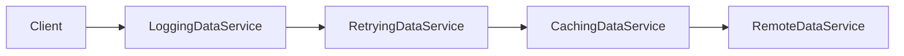

The component interface and two decorators from `structural/`:

```java
@FunctionalInterface
public interface DataService {
    String fetch(String key);
}

public final class CachingDataService implements DataService {

    private final DataService inner;
    private final ConcurrentHashMap<String, String> cache = new ConcurrentHashMap<>();

    public CachingDataService(DataService inner) {
        this.inner = Objects.requireNonNull(inner, "inner");
    }

    @Override
    public String fetch(String key) {
        return cache.computeIfAbsent(key, inner::fetch);
    }
}

public final class LoggingDataService implements DataService {

    private final DataService inner;
    private final Consumer<String> log;

    public LoggingDataService(DataService inner, Consumer<String> log) {
        this.inner = Objects.requireNonNull(inner, "inner");
        this.log = Objects.requireNonNull(log, "log");
    }

    @Override
    public String fetch(String key) {
        log.accept("fetch(" + key + ") start");
        try {
            String value = inner.fetch(key);
            log.accept("fetch(" + key + ") ok");
            return value;
        } catch (RuntimeException e) {
            log.accept("fetch(" + key + ") failed: " + e.getMessage());
            throw e;
        }
    }
}
```

Composition happens at wiring time:

```java
RemoteDataService remote = new RemoteDataService();
List<String> log = new ArrayList<>();
DataService service = new LoggingDataService(new CachingDataService(remote), log::add);

service.fetch("a");
service.fetch("a");
// remote.calls() == 1: the cache answered the second call
// log == [fetch(a) start, fetch(a) ok, fetch(a) start, fetch(a) ok]
```

| Line / API | Role | What happens at runtime |
| :--- | :--- | :--- |
| `implements DataService` on every layer | Same interface | Callers cannot tell how many layers there are. |
| `private final DataService inner` | The wrapped component | Each decorator knows only the next layer, never the concrete service. |
| `cache.computeIfAbsent(key, inner::fetch)` | Memoisation | `ConcurrentHashMap` runs the loader at most once per key, even if two threads miss at the same time. |
| `catch (RuntimeException e) { ...; throw e; }` | Transparent failure | The logger records the failure and rethrows the same exception; decorators must not swallow errors. |

**Order matters.** `Logging(Caching(remote))` logs every call, including cache hits. `Caching(Logging(remote))` logs only misses, because the cache answers hits before the logger runs. Put retries inside the cache so a successful retry is cached, and put authorisation outside the cache so unauthorised callers never read cached data.

Known uses: `java.io` (`new BufferedReader(new InputStreamReader(new FileInputStream(f)))`), `Collections.unmodifiableList` and `synchronizedList`, servlet filters wrapping `HttpServletResponse`, and Spring's `@Cacheable`/`@Transactional` (implemented with proxies, see 3.4).

| | Subclassing | Decorator |
| --- | --- | --- |
| When features are chosen | Compile time | Runtime, per instance |
| Classes for n optional features | Up to 2^n | n |
| Can wrap an existing instance | No | Yes |
| Identity | One object | `decorated != original`; `equals` and `instanceof` see the outer layer |
| Cost | None at runtime | One extra call per layer; deep stacks are harder to debug |

### 3.4 Proxy

**Intent.** Provide a stand-in that has the same interface as a real object and controls access to it.

| Proxy type | Purpose | Example |
| :--- | :--- | :--- |
| Virtual | Defer creating an expensive object until first use | Load a 50 MB image only when it is first rendered; Hibernate lazy associations |
| Protection | Check permissions before delegating | `ProtectedDocumentStore` in the starter |
| Remote | Represent an object in another process | gRPC client stubs, Java RMI stubs |
| Caching | Return stored results for repeated calls | A read-through cache in front of a slow repository |
| Smart reference | Add bookkeeping on access | Reference counting, audit logging, metrics |

Proxy and Decorator have the same structure. The difference is intent and who decides: a decorator adds features the client asked for, and clients often compose it; a proxy controls access to the subject, and the client usually does not know it is there.

The protection proxy, `structural/ProtectedDocumentStore.java`:

```java
public final class ProtectedDocumentStore implements DocumentStore {

    private final DocumentStore target;
    private final Supplier<Set<String>> currentRoles;

    public ProtectedDocumentStore(DocumentStore target, Supplier<Set<String>> currentRoles) {
        this.target = Objects.requireNonNull(target, "target");
        this.currentRoles = Objects.requireNonNull(currentRoles, "currentRoles");
    }

    @Override
    public String read(String id) {
        require("reader", "admin");
        return target.read(id);
    }

    @Override
    public void delete(String id) {
        require("admin");
        target.delete(id);
    }

    private void require(String... anyOf) {
        Set<String> roles = currentRoles.get();
        for (String role : anyOf) {
            if (roles.contains(role)) {
                return;
            }
        }
        throw new AccessDeniedException("requires one of " + String.join(", ", anyOf) + "; caller has " + roles);
    }
}
```

The `Supplier<Set<String>>` is read on every call, so the proxy always checks the current caller. In a server, that supplier reads a request-scoped value (a `ScopedValue` on Java 25, see V.3).

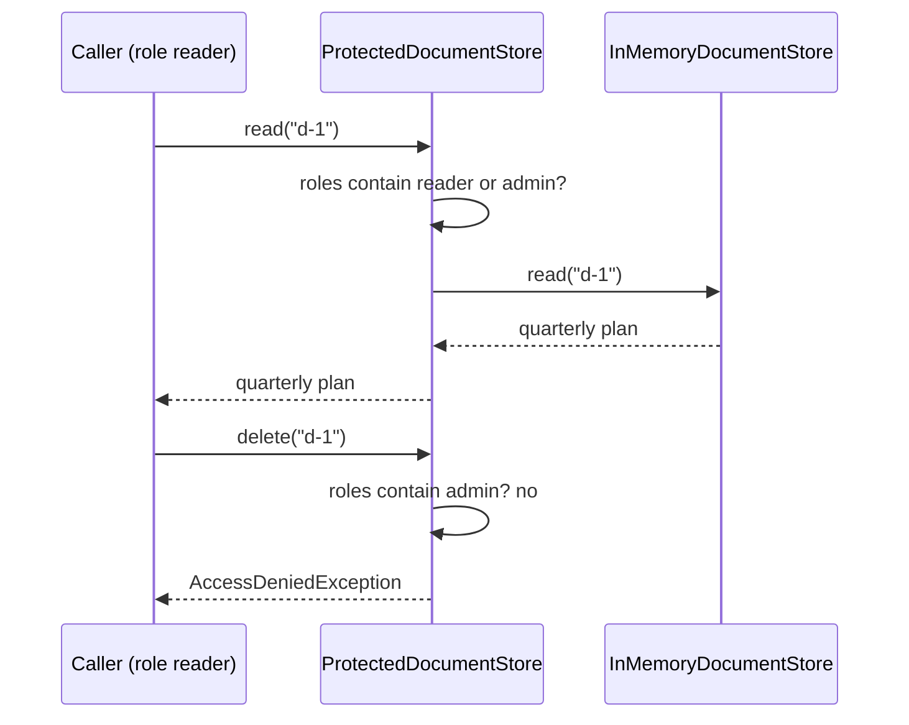

#### Dynamic proxies

Writing one proxy class per interface does not scale. `java.lang.reflect.Proxy` generates a proxy class at runtime for any interface and routes every call to one `InvocationHandler`. This is how frameworks add transactions, metrics and security to beans. The starter's `structural/RecordingProxy.java`:

```java
public final class RecordingProxy {

    private RecordingProxy() {
    }

    public static <T> T wrap(Class<T> type, T target, List<String> log) {
        if (!type.isInterface()) {
            throw new IllegalArgumentException(type.getName() + " is not an interface; JDK proxies need one");
        }
        InvocationHandler handler = (proxy, method, args) -> {
            log.add(method.getName() + Arrays.toString(args == null ? new Object[0] : args));
            try {
                return method.invoke(target, args);
            } catch (InvocationTargetException e) {
                throw e.getCause(); // rethrow what the target threw, not the reflection wrapper
            }
        };
        return type.cast(Proxy.newProxyInstance(type.getClassLoader(), new Class<?>[] {type}, handler));
    }
}
```

| Line / API | Role | What happens at runtime |
| :--- | :--- | :--- |
| `type.isInterface()` check | Precondition | JDK proxies implement interfaces only; proxying a class needs bytecode generation (ByteBuddy, used by Spring's CGLIB-style proxies and Mockito). |
| `InvocationHandler` lambda | One handler for all methods | Receives the proxy, the `Method` being called and its arguments (`null` when there are none). |
| `method.invoke(target, args)` | Delegation by reflection | Calls the same method on the real object. |
| `catch (InvocationTargetException e) { throw e.getCause(); }` | Exception transparency | Without it, callers would get `UndeclaredThrowableException` instead of the real `NoSuchElementException`. |
| `Proxy.newProxyInstance(...)` | Class generation | Creates (and caches) a proxy class implementing `type`, then instantiates it with the handler. |
| `type.cast(...)` | Type-safe return | Avoids an unchecked cast warning. |

A well-known consequence: Spring's proxy-based `@Transactional` does not apply when a bean calls its own annotated method (`this.save()`), because that call never goes through the proxy.

### 3.5 Facade

**Intent.** Offer one simple interface to a set of classes that together perform a task.

**Forces.** Checking out an order touches a discount rule, a tax rule, an order processor, a payment adapter, a legacy payment service and a notifier. Every caller that needs "check out" should not have to know that wiring.

```java
public final class CheckoutFacade {

    private final OrderProcessor processor;
    private final AtomicLong orderSequence = new AtomicLong();

    public CheckoutFacade(PaymentGateway payments, Notifier notifier, TaxCalculator tax) {
        this.processor = new OrderProcessor(tax, payments, notifier);
    }

    public static CheckoutFacade withLegacyPayments(Notifier notifier) {
        return new CheckoutFacade(new LegacyPaymentAdapter(new LegacyXmlPaymentService()), notifier, new FlatRateTax(8));
    }

    public Receipt checkout(String customerId, String email, Money subtotal, DiscountStrategy discount) {
        Money discounted = discount.apply(subtotal);
        String orderId = "ORD-" + orderSequence.incrementAndGet();
        return processor.process(new Order(orderId, customerId, email, discounted));
    }
}
```

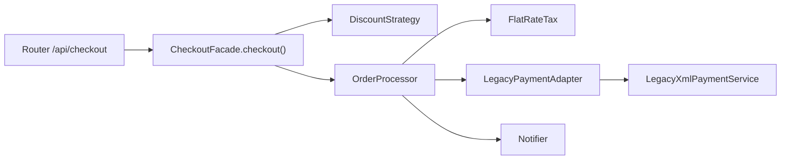

| Line / API | Role | What happens at runtime |
| :--- | :--- | :--- |
| Public constructor taking three ports | Testable entry | Tests pass fakes; the facade does not force its defaults on anyone. |
| `withLegacyPayments(...)` | Convenience wiring | The common configuration in one static factory. |
| `AtomicLong orderSequence` | Facade-owned state | Thread-safe id generation; virtual threads may call `checkout` concurrently. |
| `checkout(...)` | The simplified operation | One call runs discount, tax, payment and notification. |

A facade simplifies; it does not hide by force. `OrderProcessor` and the adapter stay public for callers that need finer control. Two failure modes: the facade grows a method for every subsystem feature (it becomes a god class), or business rules move into it (it should coordinate, not decide). `CheckoutFacade` contains no rule of its own except id generation.

Facade vs Adapter: both put a new interface in front of existing code. An adapter makes one object fit an interface that already exists; a facade defines a new, smaller interface over many objects.

### 3.6 Composite

**Intent.** Compose objects into trees and let clients treat a single object and a group of objects the same way.

**Forces.** File systems, UI component trees, organisation charts, menus and expression trees all mix leaves and containers. Without a common interface, every operation needs `if (node instanceof Directory)` branches.

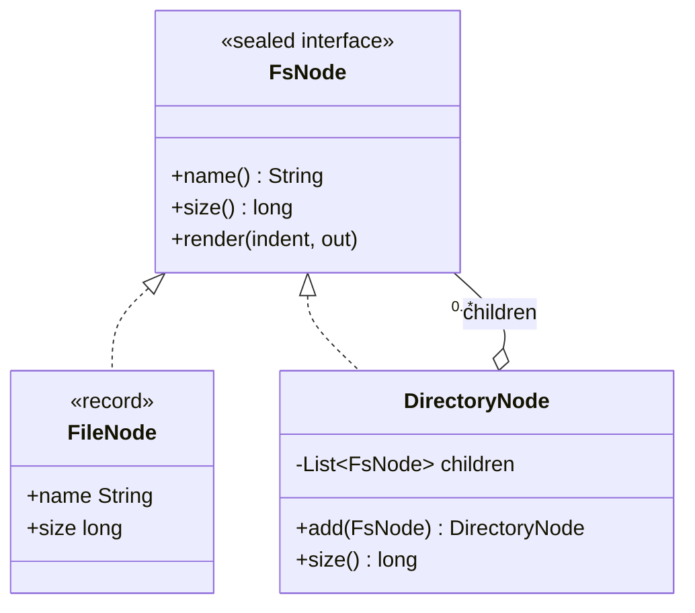

The starter's version uses a sealed interface, so the set of node kinds is closed and known to the compiler:

```java
public sealed interface FsNode permits FileNode, DirectoryNode {

    String name();

    long size();

    void render(String indent, StringBuilder out);

    default String render() {
        StringBuilder out = new StringBuilder();
        render("", out);
        return out.toString();
    }
}

public record FileNode(String name, long size) implements FsNode {

    @Override
    public void render(String indent, StringBuilder out) {
        out.append(indent).append(name).append(" (").append(size).append(" B)\n");
    }
}

public final class DirectoryNode implements FsNode {

    private final String name;
    private final List<FsNode> children = new ArrayList<>();

    public DirectoryNode(String name) {
        this.name = Objects.requireNonNull(name, "name");
    }

    public DirectoryNode add(FsNode child) {
        if (child == this) {
            throw new IllegalArgumentException("a directory cannot contain itself");
        }
        children.add(Objects.requireNonNull(child, "child"));
        return this;
    }

    @Override
    public String name() {
        return name;
    }

    @Override
    public long size() {
        return children.stream().mapToLong(FsNode::size).sum();
    }

    @Override
    public void render(String indent, StringBuilder out) {
        out.append(indent).append(name).append("/ (").append(size()).append(" B)\n");
        for (FsNode child : children) {
            child.render(indent + "  ", out);
        }
    }
}
```

```java
DirectoryNode root = new DirectoryNode("workspace")
        .add(new FileNode("README.md", 1_200))
        .add(new DirectoryNode("src").add(new FileNode("App.java", 450)).add(new FileNode("app.css", 300)));

root.size();    // 1950
root.render();
// workspace/ (1950 B)
//   README.md (1200 B)
//   src/ (750 B)
//     App.java (450 B)
//     app.css (300 B)
```

| Component | Role in Composite | Guarantee |
| :--- | :--- | :--- |
| `FsNode` | Component | Declares the operations every node supports (`size`, `render`). |
| `FileNode` | Leaf | Does the work directly; has no children. |
| `DirectoryNode` | Composite | Holds children and delegates each operation to them recursively. |

**Where do `add`/`remove` live?** GoF discusses two designs. *Transparency* declares child management on the component, so clients never check the type, but `file.add(...)` must then throw. *Safety* declares it only on the composite, as the starter does, so misuse is a compile error and clients that build trees must know they hold a `DirectoryNode`. Prefer safety in Java: an `UnsupportedOperationException` from a leaf is the LSP problem from Stage 1.

Deep trees and recursion: `size()` recurses once per level, so a pathological tree thousands of levels deep can throw `StackOverflowError`. Real file trees are shallow; for untrusted input (a parsed JSON document, for example), use an explicit stack or a depth limit. `DirectoryNode.add` rejects only direct self-containment; preventing cycles through deeper paths needs a parent check.

### 3.7 Flyweight

**Intent.** Share fine-grained objects so that large numbers of them use little memory.

**Forces.** A text editor showing a million characters, a game with 100,000 trees, or a map with millions of markers would create an object per item. Most of each object's data is the same across items.

The trick is to split state:

- **Intrinsic state** is shared and immutable: a glyph's character, font and size; a tree's mesh and texture.
- **Extrinsic state** varies per use and is passed in by the caller: the glyph's position on the page; the tree's coordinates.

```java
public final class GlyphFactory {

    public record Glyph(char symbol, String font, int pointSize) {
        public String drawAt(int x, int y) {                // x, y are extrinsic
            return symbol + "@" + x + "," + y + " [" + font + " " + pointSize + "pt]";
        }
    }

    private record Key(char symbol, String font, int pointSize) {
    }

    private final Map<Key, Glyph> pool = new ConcurrentHashMap<>();

    public Glyph glyph(char symbol, String font, int pointSize) {
        return pool.computeIfAbsent(new Key(symbol, font, pointSize), k -> new Glyph(k.symbol(), k.font(), k.pointSize()));
    }

    public int pooled() {
        return pool.size();
    }
}
```

Rendering "banana" asks for six glyphs and creates three (`b`, `a`, `n`). The `Key` record gives correct `equals`/`hashCode` for free; a hand-built string key such as `symbol + "|" + font` works too but breaks if a font name ever contains the separator.

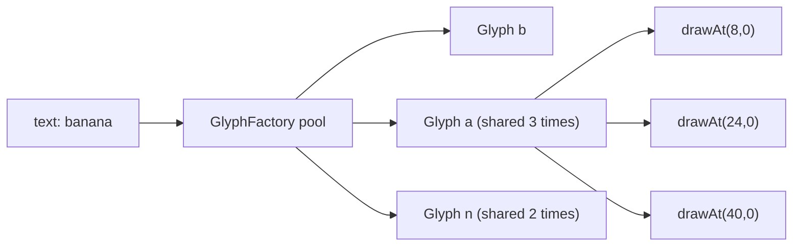

The JDK uses the pattern itself: `Integer.valueOf`, `Long.valueOf`, `Short.valueOf`, `Byte.valueOf` and `Character.valueOf` cache small values (the `Integer` cache covers -128 to 127), `Boolean.valueOf` returns one of two constants, and string literals are interned. This is why `Integer a = 127, b = 127; a == b` is `true` while the same with 128 is `false`: always compare boxed values with `equals`.

Flyweights must be immutable, since every holder shares them. Measure before applying the pattern: it pays off at hundreds of thousands of instances, and it costs a lookup per access plus the discipline of passing extrinsic state everywhere.

### 3.8 Bridge

**Intent.** Separate an abstraction from its implementation so the two can vary independently.

**Forces.** Alerts come in kinds (info, urgent) and travel through channels (console, Slack, SMS, pager). With inheritance alone you get `InfoConsoleAlert`, `InfoSlackAlert`, `UrgentConsoleAlert`, and so on: kinds x channels classes. Bridge turns one of the dimensions into a field.

```java
public abstract class Alert {

    @FunctionalInterface
    public interface MessageSender {          // implementor
        void send(String channel, String text);
    }

    protected final MessageSender sender;     // the bridge

    protected Alert(MessageSender sender) {
        this.sender = Objects.requireNonNull(sender, "sender");
    }

    public abstract void raise(String text);

    public static final class Info extends Alert {
        public Info(MessageSender sender) {
            super(sender);
        }

        @Override
        public void raise(String text) {
            sender.send("info", text);
        }
    }

    public static final class Urgent extends Alert {
        public Urgent(MessageSender sender) {
            super(sender);
        }

        @Override
        public void raise(String text) {
            sender.send("pager", "URGENT: " + text);
            sender.send("info", "escalated: " + text);
        }
    }
}
```

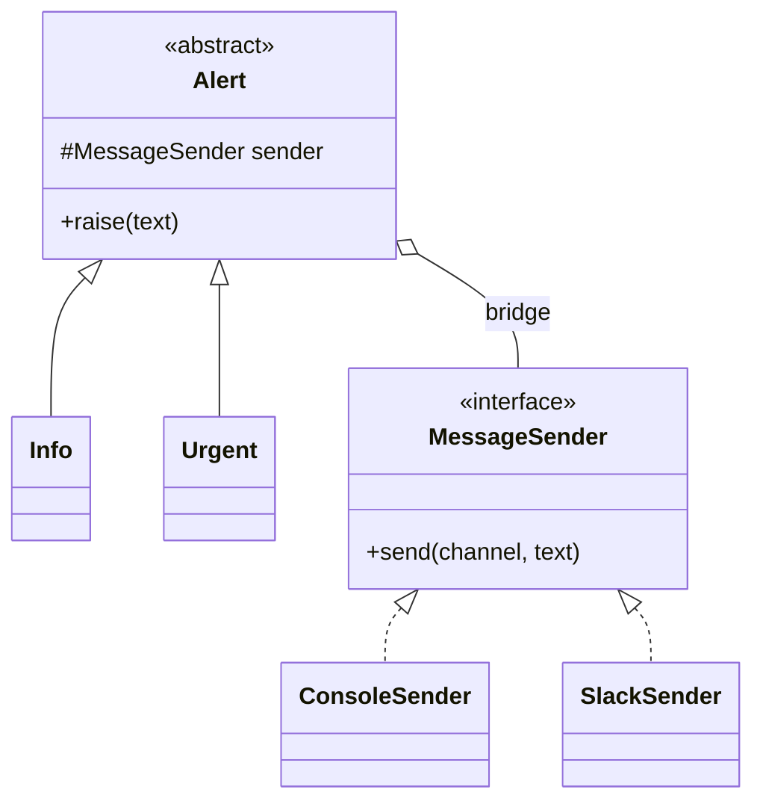

Two alert kinds and N senders now need 2 + N classes. JDBC is the textbook real-world bridge: your code uses the `java.sql` abstraction (`Connection`, `PreparedStatement`) and each driver supplies the implementation. SLF4J is another: the logging API on one side, Logback or Log4j on the other.

Bridge vs Strategy: structurally both hold an interface in a field. Bridge is designed up front to keep two hierarchies independent for the life of the code; Strategy swaps one algorithm, often at runtime. Bridge vs Adapter: a bridge is planned before the implementations exist; an adapter is applied afterwards to make existing classes fit.

### 3.9 Adapter vs Decorator vs Proxy vs Facade

| Question | Adapter | Decorator | Proxy | Facade |
| --- | --- | --- | --- | --- |
| Changes the interface? | Yes, to the target | No | No | Yes, a new simpler one |
| Adds behaviour? | Only translation | Yes, the point of it | Access control, laziness, remoting | Coordination only |
| Number of wrapped objects | One | One | One | Many |
| Who composes it? | The wiring code, once | Often the client, stacked | Framework or wiring; client unaware | The wiring code |
| Typical lifetime | Permanent, at a boundary | Configurable per use | Permanent | Permanent |
| Starter example | `LegacyPaymentAdapter` | `CachingDataService`, `LoggingDataService`, `RetryingDataService` | `ProtectedDocumentStore`, `RecordingProxy` | `CheckoutFacade` |
| JDK example | `InputStreamReader` | `BufferedInputStream` | `java.lang.reflect.Proxy` | `java.net.http.HttpClient` over sockets, TLS and HTTP/2 |

A quick test in reviews: ask "what would break if I removed this wrapper?" Removing an adapter breaks compilation (wrong interface). Removing a decorator removes a feature. Removing a proxy removes a guarantee (security, laziness). Removing a facade makes callers do more work.

### 3.10 Pitfalls

| Pitfall | Symptom | Fix |
| --- | --- | --- |
| Adapter leaks the adaptee's types | Callers catch `LegacyXmlException` or import vendor classes | Translate every type and exception at the adapter boundary. |
| Decorator swallows exceptions | Failures disappear; callers get `null` | Log and rethrow, or convert to a documented domain exception. |
| Wrong decorator order | Cache serves data to unauthorised users, or retries bypass the cache | Write down the intended order and assert it in a test; put auth outermost. |
| Recursive `computeIfAbsent` on the same `ConcurrentHashMap` | `IllegalStateException: Recursive update` | Do not call back into the same map from the loader; compute outside and `putIfAbsent`. |
| Dynamic proxy without unwrapping | Callers see `UndeclaredThrowableException` or `InvocationTargetException` | Catch `InvocationTargetException` and rethrow `getCause()`. |
| Proxying a class with JDK `Proxy` | `IllegalArgumentException: ... is not an interface` | Proxy an interface, or use a bytecode library. |
| Self-invocation bypasses a framework proxy | `@Transactional` or `@Cacheable` silently ignored on `this.method()` | Call through the injected bean, or move the method to another bean. |
| Facade becomes a god class | Dozens of methods, business rules inside | Keep it to coordination; split by use case. |
| Leaf implements `add` and throws | `UnsupportedOperationException` deep in tree-building code | Declare child management only on the composite. |
| Mutable flyweight | Changing one glyph's font changes every occurrence | Make flyweights records; pass varying data as arguments. |
| Comparing boxed numbers with `==` | `Integer.valueOf(128) == Integer.valueOf(128)` is `false` | Use `equals` or unbox. |

### 3.11 Best Practices

- **Keep adapters thin and at the boundary**: translation only, so the domain never sees the foreign model.
- **Make every decorator implement the full interface and delegate by default**: callers must not see a difference except the added behaviour.
- **Wire decorator stacks in one place**: the order is a design decision and deserves one readable line.
- **Prefer a `Supplier` or scoped value for caller context in proxies**: the check reads the current caller, not one captured at construction.
- **Unwrap `InvocationTargetException` in every reflective proxy**: exceptions must look the same with or without the proxy.
- **Keep facades free of business rules**: they coordinate; rules stay in the classes they call.
- **Use sealed interfaces for composites**: the compiler knows every node kind, which pays off when you add `switch`-based operations in Stage 5.
- **Measure before adding a Flyweight**: it trades memory for lookups and complexity.

### 3.12 Hands-on Exercise

**Task.** Write a `RetryingDataService` decorator that retries a failing `fetch` up to `maxAttempts` times and rethrows the last exception if every attempt fails. Then stack it with the existing decorators so that a flaky remote call is retried, the successful result is cached, and every external call is logged.

**Expected output.** For a service that fails twice then succeeds, wrapped as `new RetryingDataService(flaky, 3)`:

```text
fetch("k") -> "ok:k" after 3 attempts
with maxAttempts = 2 -> IllegalStateException("timeout #2")
```

A good full stack is `new LoggingDataService(new CachingDataService(new RetryingDataService(remote, 3)), log::add)`: the cache sits outside the retry so a recovered value is stored, and the logger is outermost so it records every request.

**Solution.** `src/main/java/org/thelearninghub/patterns/structural/RetryingDataService.java` and the test `retryingDecoratorRecoversFromTransientFailures` in `src/test/java/org/thelearninghub/patterns/StructuralTest.java`. For production, add a backoff between attempts and retry only exceptions known to be transient.

[Back to top ⤴️](#-table-of-contents)

---

## 4. Stage 4: Behavioral Patterns: Events, State & Strategy

Behavioral patterns assign responsibilities between objects and define how they communicate. This stage covers the four you will use most in application code: Observer, Strategy, Command and State.

```mermaid
flowchart LR
    Event["Something happened"] --> Observer["Observer: tell every subscriber"]
    Choice["Pick an algorithm"] --> Strategy["Strategy: swap it at runtime"]
    Request["A request to run later or undo"] --> Command["Command: make it an object"]
    Lifecycle["Behaviour depends on lifecycle"] --> State["State: one class per state"]
```

### 4.1 Observer Pattern & Event-Driven Decoupling

Observer defines a one-to-many dependency: when the subject changes, every registered observer is notified, and the subject knows them only through an interface.

```mermaid
flowchart TD
    Subject["EventBus (subject)"] -->|"publish(order.created)"| Obs1["Email subscriber"]
    Subject -->|"publish(order.created)"| Obs2["Analytics subscriber"]
    Subject -->|"publish(order.created)"| Obs3["Inventory subscriber"]
```

The starter's `behavioral/EventBus.java` is a typed, thread-safe subject. `subscribe` returns a handle that removes the subscriber, because forgotten listeners are the classic Observer memory leak:

```java
public final class EventBus<E> {

    private final List<Consumer<? super E>> subscribers = new CopyOnWriteArrayList<>();

    public Runnable subscribe(Consumer<? super E> subscriber) {
        Objects.requireNonNull(subscriber, "subscriber");
        subscribers.add(subscriber);
        return () -> subscribers.remove(subscriber);
    }

    public void publish(E event) {
        for (Consumer<? super E> subscriber : subscribers) {
            subscriber.accept(event);
        }
    }

    public int subscriberCount() {
        return subscribers.size();
    }
}
```

`CopyOnWriteArrayList` lets a subscriber unsubscribe during `publish` without a `ConcurrentModificationException`; the loop iterates over a snapshot. It suits lists that are read far more often than they change.

### 4.2 Strategy Pattern (Pluggable Algorithms)

Strategy encapsulates each algorithm of a family behind one interface so the caller can swap them at runtime. With Java lambdas a strategy no longer needs its own class. `behavioral/DiscountStrategy.java`:

```java
@FunctionalInterface
public interface DiscountStrategy {

    Money apply(Money subtotal);

    static DiscountStrategy none() {
        return subtotal -> subtotal;
    }

    static DiscountStrategy percentOff(int percent) {
        if (percent < 0 || percent > 100) {
            throw new IllegalArgumentException("percent must be between 0 and 100, was " + percent);
        }
        return subtotal -> subtotal.minus(subtotal.percent(percent));
    }

    static DiscountStrategy forTier(String tier) {
        return switch (tier.toLowerCase(Locale.ROOT)) {
            case "regular" -> none();
            case "member" -> percentOff(5);
            case "vip" -> percentOff(20);
            default -> throw new IllegalArgumentException("Unknown tier: " + tier);
        };
    }
}
```

`CheckoutFacade.checkout(..., DiscountStrategy discount)` is the context: it calls `discount.apply(subtotal)` and never knows which rule it got.

### 4.3 Command Pattern (Undo/Redo Stacks)

Command turns a request into an object, so it can be queued, logged, retried or undone.

```java
import java.util.ArrayDeque;
import java.util.Deque;

interface Command {
    void execute();

    void undo();
}

final class DocumentEditor {
    private final StringBuilder content = new StringBuilder();

    void write(String text) {
        content.append(text);
    }

    void deleteLast(int count) {
        content.setLength(content.length() - count);
    }

    String text() {
        return content.toString();
    }
}

record WriteTextCommand(DocumentEditor editor, String text) implements Command {
    public void execute() {
        editor.write(text);
    }

    public void undo() {
        editor.deleteLast(text.length());
    }
}

final class CommandHistory {
    private final Deque<Command> done = new ArrayDeque<>();
    private final Deque<Command> undone = new ArrayDeque<>();

    void run(Command command) {
        command.execute();
        done.push(command);
        undone.clear(); // a new action invalidates the redo stack
    }

    void undo() {
        if (!done.isEmpty()) {
            Command command = done.pop();
            command.undo();
            undone.push(command);
        }
    }

    void redo() {
        if (!undone.isEmpty()) {
            Command command = undone.pop();
            command.execute();
            done.push(command);
        }
    }
}

class CommandDemo {
    public static void main(String[] args) {
        DocumentEditor editor = new DocumentEditor();
        CommandHistory history = new CommandHistory();
        history.run(new WriteTextCommand(editor, "Hello"));
        history.run(new WriteTextCommand(editor, ", world"));
        history.undo();
        System.out.println(editor.text()); // Hello
        history.redo();
        System.out.println(editor.text()); // Hello, world
    }
}
```

### 4.4 State Pattern: Document Workflow Engine

State moves behaviour that depends on a lifecycle into one class per state. The context delegates to its current state, and states decide the transitions.

```mermaid
stateDiagram-v2
    [*] --> Draft
    Draft --> Moderation : publish()
    Moderation --> Published : publish() (approved)
    Moderation --> Draft : reject()
    Published --> Published : publish() is a no-op
```

```java
interface DocumentState {
    DocumentState publish();

    DocumentState reject();

    String render();
}

final class DocumentWorkflow {
    private DocumentState state = new Draft();

    void publish() {
        state = state.publish();
    }

    void reject() {
        state = state.reject();
    }

    String render() {
        return state.render();
    }
}

record Draft() implements DocumentState {
    public DocumentState publish() { return new Moderation(); }
    public DocumentState reject() { return this; }
    public String render() { return "[DRAFT] watermarked preview"; }
}

record Moderation() implements DocumentState {
    public DocumentState publish() { return new Published(); }
    public DocumentState reject() { return new Draft(); }
    public String render() { return "[MODERATION] pending editor approval"; }
}

record Published() implements DocumentState {
    public DocumentState publish() { return this; }
    public DocumentState reject() { throw new IllegalStateException("published documents cannot be rejected"); }
    public String render() { return "[PUBLIC] live document"; }
}

class WorkflowDemo {
    public static void main(String[] args) {
        DocumentWorkflow doc = new DocumentWorkflow();
        System.out.println(doc.render()); // [DRAFT] watermarked preview
        doc.publish();
        doc.reject();
        doc.publish();
        doc.publish();
        System.out.println(doc.render()); // [PUBLIC] live document
    }
}
```

Returning the next state (instead of calling `context.setState(...)` from inside the state, as the GoF sample does) keeps states free of a back-reference to the context and makes each transition a pure function that is easy to test.

| State class | Allowed transitions | Invariant enforced |
| :--- | :--- | :--- |
| `Draft` | `publish()` to `Moderation` | Unreviewed drafts never become public. |
| `Moderation` | `publish()` to `Published`, `reject()` to `Draft` | Requires an editor decision. |
| `Published` | None (terminal) | Live documents are read-only. |

[Back to top ⤴️](#-table-of-contents)

---

## 5. Stage 5: Behavioral Patterns: Workflow & Traversal

This stage covers patterns that route requests through several objects or walk object structures: Chain of Responsibility, Mediator and Visitor.

```mermaid
flowchart LR
    Request["HTTP request"] --> Auth["auth"]
    Auth -->|"valid token"| Rate["rate limit"]
    Rate -->|"within quota"| Validate["validation"]
    Validate -->|"payload clean"| Controller["controller"]
```

### 5.1 Chain of Responsibility (Middleware Pipelines)

Chain of Responsibility passes a request along a list of handlers; each one handles it, changes it, passes it on, or stops the chain. The starter's router is built on `behavioral/MiddlewareChain.java`:

```java
public final class MiddlewareChain<C> {

    @FunctionalInterface
    public interface Middleware<C> {
        void handle(C context, Runnable next);
    }

    private final List<Middleware<C>> middlewares = new ArrayList<>();

    public MiddlewareChain<C> use(Middleware<C> middleware) {
        middlewares.add(Objects.requireNonNull(middleware, "middleware"));
        return this;
    }

    public C execute(C context) {
        dispatch(0, context);
        return context;
    }

    private void dispatch(int index, C context) {
        if (index < middlewares.size()) {
            middlewares.get(index).handle(context, () -> dispatch(index + 1, context));
        }
    }
}
```

`web/Router.java` registers three handlers: a metrics counter, a GET-only guard that responds `405` and returns without calling `next`, and the route table. Servlet filters, Spring Security's filter chain and Netty's channel pipeline follow the same design.

### 5.2 Mediator Pattern

Mediator replaces many-to-many links between peers with one coordinator. Each peer talks only to the mediator, which decides who reacts. Air traffic control is the usual analogy: aircraft do not negotiate runways with each other.

```mermaid
flowchart TD
    P1["Aircraft 1"] <--> ATC["Control tower (mediator)"]
    P2["Aircraft 2"] <--> ATC
    P3["Aircraft 3"] <--> ATC
    ATC <--> Runway["Runway"]
```

```java
import java.util.ArrayDeque;
import java.util.Deque;

final class ControlTower {
    private String runwayHolder;
    private final Deque<String> waiting = new ArrayDeque<>();

    String requestLanding(String flight) {
        if (runwayHolder == null) {
            runwayHolder = flight;
            return flight + ": cleared to land";
        }
        waiting.add(flight);
        return flight + ": hold, position " + waiting.size();
    }

    String runwayClear(String flight) {
        if (!flight.equals(runwayHolder)) {
            throw new IllegalStateException(flight + " does not hold the runway");
        }
        runwayHolder = waiting.poll();
        return runwayHolder == null ? "runway free" : runwayHolder + ": cleared to land";
    }
}

class TowerDemo {
    public static void main(String[] args) {
        ControlTower tower = new ControlTower();
        System.out.println(tower.requestLanding("LH400")); // LH400: cleared to land
        System.out.println(tower.requestLanding("BA117")); // BA117: hold, position 1
        System.out.println(tower.runwayClear("LH400"));    // BA117: cleared to land
    }
}
```

### 5.3 Visitor Pattern & Double Dispatch: Expression Evaluator

Visitor adds operations to a class hierarchy without editing the classes. Java dispatches a method call on the runtime type of the receiver only (single dispatch). Visitor gets a second dispatch on the visitor's type: `expr.accept(visitor)` picks the element type, and the element calls back `visitor.visitBinary(this)`, which picks the operation.

```java
interface ExpressionVisitor<R> {
    R visitNumber(NumberLiteral expr);

    R visitBinary(BinaryExpression expr);
}

interface Expression {
    <R> R accept(ExpressionVisitor<R> visitor);
}

record NumberLiteral(long value) implements Expression {
    public <R> R accept(ExpressionVisitor<R> visitor) {
        return visitor.visitNumber(this);
    }
}

record BinaryExpression(Expression left, char operator, Expression right) implements Expression {
    public <R> R accept(ExpressionVisitor<R> visitor) {
        return visitor.visitBinary(this);
    }
}

final class Evaluator implements ExpressionVisitor<Long> {
    public Long visitNumber(NumberLiteral expr) {
        return expr.value();
    }

    public Long visitBinary(BinaryExpression expr) {
        long left = expr.left().accept(this);
        long right = expr.right().accept(this);
        return switch (expr.operator()) {
            case '+' -> left + right;
            case '-' -> left - right;
            case '*' -> left * right;
            default -> throw new IllegalArgumentException("unknown operator " + expr.operator());
        };
    }
}

final class Printer implements ExpressionVisitor<String> {
    public String visitNumber(NumberLiteral expr) {
        return Long.toString(expr.value());
    }

    public String visitBinary(BinaryExpression expr) {
        return "(" + expr.left().accept(this) + " " + expr.operator() + " " + expr.right().accept(this) + ")";
    }
}

class VisitorDemo {
    public static void main(String[] args) {
        Expression e = new BinaryExpression(new NumberLiteral(2), '+',
                new BinaryExpression(new NumberLiteral(3), '*', new NumberLiteral(4)));
        System.out.println(e.accept(new Printer()) + " = " + e.accept(new Evaluator())); // (2 + (3 * 4)) = 14
    }
}
```

| Visitor | What it does | Why Visitor helps |
| :--- | :--- | :--- |
| `Evaluator` | Computes the value of the tree | New operations need no change to the expression classes. |
| `Printer` | Renders `(2 + (3 * 4))` | Each operation lives in one cohesive class. |

The cost is the reverse: adding a new expression type means changing every visitor. When the hierarchy is closed, Java 21's sealed interfaces with an exhaustive `switch` over record patterns give the same "operations outside the classes" benefit with less ceremony.

[Back to top ⤴️](#-table-of-contents)

---

## 6. Stage 6: Enterprise Architectural Patterns

Enterprise patterns organise whole applications around persistence, consistency and scale. This stage covers Repository, Unit of Work, CQRS and Event Sourcing.

```mermaid
flowchart LR
    Controller["Controller"] --> Service["Application service"]
    Service --> Repo["Repository (port)"]
    Repo --> Impl["JDBC / JPA adapter"]
    Impl --> DB["Database"]
```

### 6.1 Repository Pattern & Unit of Work

- **Repository** gives the domain a collection-like interface (`findById`, `save`, `remove`) for aggregates and hides how they are stored.
- **Unit of Work** records which objects a business transaction created, changed or removed, then writes all of it in one database transaction.

```mermaid
flowchart TD
    Service["BillingService"] --> UoW["Unit of Work"]
    UoW --> UserRepo["UserRepository"]
    UoW --> InvoiceRepo["InvoiceRepository"]
    UoW -->|"commit: one transaction"| Database["PostgreSQL"]
```

```java
import java.util.Map;
import java.util.Optional;
import java.util.concurrent.ConcurrentHashMap;

record Invoice(String id, String customerId, long amountCents, boolean paid) {}

interface InvoiceRepository {
    Optional<Invoice> findById(String id);

    void save(Invoice invoice);
}

final class InMemoryInvoiceRepository implements InvoiceRepository {
    private final Map<String, Invoice> rows = new ConcurrentHashMap<>();

    public Optional<Invoice> findById(String id) {
        return Optional.ofNullable(rows.get(id));
    }

    public void save(Invoice invoice) {
        rows.put(invoice.id(), invoice);
    }
}
```

In JPA, the `EntityManager`'s persistence context is the Unit of Work: it tracks managed entities and flushes their changes at commit.

### 6.2 CQRS & Event Sourcing

- **CQRS (Command Query Responsibility Segregation)** separates the model that handles writes from the model that answers reads. Writes go to a normalised store with full validation; reads come from projections shaped for each screen, which may live in a different store.
- **Event Sourcing** stores every state change as an immutable event (`AccountOpened`, `MoneyDeposited`, `MoneyWithdrawn`) in an append-only log. Current state is derived by replaying the events.

```mermaid
flowchart LR
    Command["Command: deposit 50"] --> EventStore["Event store (append-only)"]
    EventStore --> Projection["Projector"]
    Projection --> ReadDB["Read model"]
    Query["Query: get balance"] --> ReadDB
```

```java
import java.util.List;

sealed interface AccountEvent permits Opened, Deposited, Withdrawn {}
record Opened(String accountId) implements AccountEvent {}
record Deposited(long cents) implements AccountEvent {}
record Withdrawn(long cents) implements AccountEvent {}

final class BalanceProjection {
    static long replay(List<AccountEvent> events) {
        long balance = 0;
        for (AccountEvent event : events) {
            balance = switch (event) {
                case Opened o -> 0;
                case Deposited d -> balance + d.cents();
                case Withdrawn w -> balance - w.cents();
            };
        }
        return balance;
    }

    public static void main(String[] args) {
        System.out.println(replay(List.of(new Opened("a-1"), new Deposited(5_000), new Withdrawn(1_200)))); // 3800
    }
}
```

[Back to top ⤴️](#-table-of-contents)

---

## M1. Masterclass: Building a Dependency Injection Container

Spring, Guice, Dagger and Jakarta CDI all solve one problem: build an object graph from registrations, honour lifetimes, and fail clearly when the graph is wrong. Building a small container shows what the frameworks do for you and where their errors come from. The code is `src/main/java/org/thelearninghub/patterns/enterprise/Container.java`, tested in `ContainerTest`.

### M1.1 How a Container Resolves a Graph

```mermaid
flowchart TD
    Resolve["resolve(OrderProcessor)"] --> Lookup{"Registered?"}
    Lookup -->|no| Missing["throw: No registration"]
    Lookup -->|yes| Cached{"Singleton already built?"}
    Cached -->|yes| Return["return cached instance"]
    Cached -->|no| Cycle{"Type already on the resolving stack?"}
    Cycle -->|yes| CycleErr["throw: Dependency cycle A -> B -> A"]
    Cycle -->|no| Push["push type, call factory"]
    Push --> Deps["factory calls resolve() for each dependency"]
    Deps --> Store["singleton: cache it"]
    Store --> Pop["pop type, return instance"]
```

Inversion of Control is the general idea (the framework calls your code); Dependency Injection is the specific technique (collaborators are handed to an object instead of being created by it). A container automates the composition root.

### M1.2 Worked Example

```java
public final class Container {

    public enum Lifetime { SINGLETON, TRANSIENT }

    private record Registration<T>(Function<Container, T> factory, Lifetime lifetime) {
    }

    private final Map<Class<?>, Registration<?>> registrations = new HashMap<>();
    private final Map<Class<?>, Object> singletons = new HashMap<>();
    private final Deque<Class<?>> resolving = new ArrayDeque<>();

    public <T> Container singleton(Class<T> type, Function<Container, T> factory) {
        return register(type, factory, Lifetime.SINGLETON);
    }

    public <T> Container transientService(Class<T> type, Function<Container, T> factory) {
        return register(type, factory, Lifetime.TRANSIENT);
    }

    private <T> Container register(Class<T> type, Function<Container, T> factory, Lifetime lifetime) {
        Objects.requireNonNull(type, "type");
        Objects.requireNonNull(factory, "factory");
        if (registrations.putIfAbsent(type, new Registration<>(factory, lifetime)) != null) {
            throw new IllegalStateException(type.getSimpleName() + " is already registered");
        }
        return this;
    }

    public synchronized <T> T resolve(Class<T> type) {
        Registration<?> registration = registrations.get(type);
        if (registration == null) {
            throw new IllegalStateException("No registration for " + type.getSimpleName());
        }
        if (registration.lifetime() == Lifetime.SINGLETON && singletons.containsKey(type)) {
            return type.cast(singletons.get(type));
        }
        if (resolving.contains(type)) {
            StringBuilder path = new StringBuilder();
            resolving.descendingIterator().forEachRemaining(t -> path.append(t.getSimpleName()).append(" -> "));
            throw new IllegalStateException("Dependency cycle: " + path + type.getSimpleName());
        }
        resolving.push(type);
        try {
            T instance = type.cast(registration.factory().apply(this));
            if (registration.lifetime() == Lifetime.SINGLETON) {
                singletons.put(type, instance);
            }
            return instance;
        } finally {
            resolving.pop();
        }
    }
}
```

Wiring the starter's checkout graph with it:

```java
Container container = new Container()
        .singleton(TaxCalculator.class, c -> new FlatRateTax(10))
        .singleton(LegacyXmlPaymentService.class, c -> new LegacyXmlPaymentService())
        .singleton(PaymentGateway.class, c -> new LegacyPaymentAdapter(c.resolve(LegacyXmlPaymentService.class)))
        .singleton(Notifier.class, c -> (to, msg) -> System.out.println(to + ": " + msg))
        .transientService(OrderProcessor.class, c -> new OrderProcessor(
                c.resolve(TaxCalculator.class), c.resolve(PaymentGateway.class), c.resolve(Notifier.class)));

OrderProcessor processor = container.resolve(OrderProcessor.class);
```

### M1.3 Lifetimes and Trade-offs

| Lifetime | Instantiation | Use for | Danger |
| :--- | :--- | :--- | :--- |
| Singleton | Once, on first resolve, then reused | Connection pools, HTTP clients, configuration, stateless services | Must be thread-safe; must not hold a shorter-lived dependency |
| Transient | On every resolve | Short-lived, stateful helpers | Expensive objects created repeatedly |
| Scoped (request, session) | Once per scope | Per-request context, a Unit of Work | Needs a scope boundary the container knows about |

A singleton that captures a transient or scoped dependency keeps that one instance forever ("captive dependency"); frameworks either forbid it or inject a proxy that looks up the current instance.

| Approach | Wiring checked | Startup cost | Error quality | Example |
| --- | --- | --- | --- | --- |
| Hand-written composition root | By the compiler | None | Compile errors | `App.java` in the starter |
| Factory-lambda container (this masterclass) | At first resolve | Tiny | Clear messages you control | `Container` |
| Reflection-based container | At startup scan | Classpath scanning and reflection | Long stack traces | Spring, Guice |
| Compile-time generated | By an annotation processor | None | Compile errors | Dagger, Micronaut |

### M1.4 Production Checklist

- Resolve the whole graph at startup (eagerly instantiate singletons) so wiring errors fail the deploy, not the first request.
- Detect cycles and report the full path.
- Reject duplicate registrations unless an override is explicit.
- Make singletons thread-safe and free of request state.
- Never call `resolve` from business code (that is the Service Locator anti-pattern); only the composition root and factories may.
- Close singletons that own resources (pools, clients) on shutdown in reverse creation order.

[Back to top ⤴️](#-table-of-contents)

---

## M2. Masterclass: Anti-Patterns & Refactoring to Patterns

An anti-pattern is a common response to a recurring problem that looks reasonable and causes more harm than it solves. This masterclass shows how they form and how to refactor out of them in small, safe steps.

### M2.1 How a Code Smell Becomes an Anti-Pattern

```mermaid
flowchart LR
    Feature["New requirement"] --> Shortcut["Quick fix: another if, another field"]
    Shortcut --> Smell["Smell: long method, type switch, shared state"]
    Smell -->|"repeated under deadline"| Anti["Anti-pattern: god object, spaghetti, golden hammer"]
    Anti --> Tests["Characterisation tests pin current behaviour"]
    Tests --> Refactor["Small refactors toward a pattern"]
    Refactor --> Clean["Seams: interfaces, strategies, states"]
```

### M2.2 Worked Example: Replace a Type Switch with Strategy

Before: pricing logic switches on a string in the middle of checkout, and every new tier edits this method.

```java
final class PricingBefore {
    static long priceCents(String tier, long subtotalCents) {
        if (tier.equals("vip")) {
            return subtotalCents - (subtotalCents * 20 + 50) / 100;
        } else if (tier.equals("member")) {
            return subtotalCents - (subtotalCents * 5 + 50) / 100;
        } else {
            return subtotalCents;
        }
    }
}
```

Steps:

1. Write characterisation tests for each branch (`vip`, `member`, anything else) using today's outputs.
2. Introduce the `DiscountStrategy` interface and move each branch body into a lambda, keeping the old method as a thin delegate.
3. Replace callers one by one with `DiscountStrategy.forTier(tier).apply(subtotal)`.
4. Delete the old method once nothing calls it. Decide explicitly what unknown tiers do: the starter throws `IllegalArgumentException("Unknown tier: gold")`, while the old code silently charged full price.

After: the starter's `DiscountStrategy` (Stage 4.2) and the test `strategiesAreInterchangeable` in `BehavioralTest`.

### M2.3 The Six Fatal Anti-Patterns

| Anti-pattern | How it shows up | Damage | Refactoring |
| :--- | :--- | :--- | :--- |
| **God Object** | One class of thousands of lines doing persistence, validation, UI and networking | High coupling; impossible to unit test | Extract classes along reasons to change (SRP); put a Facade in front if callers need one entry point |
| **Golden Hammer** | The same tool or pattern for every problem | Poor fit, performance problems | Compare options per problem; write down the trade-off |
| **Poltergeist** | Short-lived classes that only call one method on another class | Indirection with no value | Inline them |
| **Spaghetti Code** | Deeply nested conditionals, flags steering control flow | Every change risks regressions | Guard clauses, Extract Method, then State or Strategy |
| **Hard-coded Singletons** | `Database.getInstance()` called from everywhere | Tests cannot substitute fakes; hidden dependencies | Constructor injection; one instance created in the composition root |
| **Circular Dependency** | A depends on B, which depends on A | Initialisation order bugs, modules that cannot be split | Extract a shared interface, invert one edge (DIP), or introduce a Mediator or event |

### M2.4 Production Checklist

- Pin behaviour with characterisation tests before refactoring.
- Refactor in commits that each keep the build green.
- Prefer many small, reviewable steps to one large rewrite.
- Decide and document edge-case behaviour (unknown inputs, nulls) when the new design forces the question.
- Delete the old path once the new one is in use; dead branches become the next smell.

[Back to top ⤴️](#-table-of-contents)

---

## 7. Stage 7: Staff Design Patterns Software Engineer Interview Handbook & Cheatsheet

Staff-level pattern questions test judgement: when a pattern helps, what it costs, how it fails, and how you would migrate a large codebase toward or away from it.

### 7.1 Core Concepts (Q1-Q10)

#### Q1. What is the Liskov Substitution Principle, and why is Square extends Rectangle a violation?

LSP says code written against a supertype must keep working, with the same guarantees, when given any subtype. A mutable `Rectangle` promises that `setWidth` leaves the height alone. A `Square` subclass must keep its sides equal, so its `setWidth` also changes the height. A caller that does `r.setWidth(5); r.setHeight(10);` and expects an area of 50 gets 100 from a square (see the runnable demo in [1.5](#15-the-solid-principles)).

The problem is the mutators, not geometry. Fixes: model both as immutable values under a common `Shape` interface (the starter's sealed `Shape` with `Rectangle` and `Square` records), or drop the inheritance. More generally, a subtype must not strengthen preconditions, weaken postconditions or break invariants of the supertype.

#### Q2. What is the difference between the Strategy and State patterns?

Structurally they are the same: a context holds an interface reference and delegates to it. The difference is intent and who switches. With Strategy, the client chooses the algorithm (VIP pricing, CSV export) and strategies are independent of each other. With State, the context's own lifecycle drives the change (`Draft` to `Moderation` to `Published`), and the state objects know their successors.

A practical test: if the replacement happens because of an event inside the object, it is State; if it happens because a caller configured it, it is Strategy.

#### Q3. How does the Decorator pattern differ from subclassing?

Subclassing adds behaviour at compile time, per class. Combining n optional features by inheritance needs up to 2^n subclasses (`LoggingCachedEncryptedDataService`). Decorators add behaviour at runtime, per instance, by wrapping an object in another that implements the same interface; n features need n decorator classes that stack in any order.

The costs: each layer adds a call, object identity changes (the decorated object is not `==` to the original), and stack order becomes a design decision that must be documented and tested (see [3.3](#33-decorator)).

#### Q4. What is the difference between Abstract Factory and Builder?

Abstract Factory creates families of related objects, usually each in a single call (`kit.button()`, `kit.checkbox()`), and guarantees they match. Builder creates one complex object step by step and validates it once at `build()`. Use Abstract Factory when consistency across several products is the risk; use Builder when the number of optional parts and cross-field rules is the risk.

#### Q5. What is the Composite pattern, and what are real examples?

Composite arranges objects in trees where leaves and containers share one interface, so clients call `size()` or `render()` without checking which kind of node they hold. Examples: file systems (directories and files), UI toolkits (a panel containing buttons and other panels), organisation charts, and expression trees. In Java a sealed interface for the component makes the set of node kinds explicit (see [3.6](#36-composite)).

#### Q6. What is the Interface Segregation Principle, and which code smell signals a violation?

ISP says clients should not depend on methods they do not use. The smell is an implementation that stubs methods with `throw new UnsupportedOperationException()`, or a test double that must implement ten methods to exercise one. Split the interface by client role (`Reader<T>`, `Writer<T>`); a class can still implement several.

#### Q7. How does the Facade pattern promote loose coupling?

A facade gives callers one task-oriented operation over a subsystem, so they depend on the facade instead of on the subsystem's classes, construction order and wiring. The subsystem can then change internally without touching callers. `CheckoutFacade.checkout(...)` hides the discount strategy, tax rule, order processor and payment adapter behind one method. A facade should coordinate, not hold business rules.

#### Q8. What is the difference between Template Method and Strategy?

Template Method uses inheritance: a base class fixes the algorithm in a `final` method and subclasses override hook steps. Strategy uses composition: the varying step is an object passed to the context. Template Method is simpler when the steps are tied together and change together; Strategy is more flexible, testable with lambdas, and allows changing the behaviour at runtime.

#### Q9. What is the Null Object pattern?

Instead of returning `null` to mean "nothing", return an object that implements the expected interface with neutral behaviour, such as a `Notifier` that does nothing or a `DiscountStrategy.none()` that returns the subtotal unchanged. Callers stop writing `if (x != null)` checks. Use it when "do nothing" is a valid behaviour; when absence is information the caller must handle, return `Optional` instead.

#### Q10. What is Inversion of Control, and how does it relate to Dependency Injection?

Inversion of Control is the broad principle that a framework or container calls your code rather than your code calling it ("don't call us, we'll call you"). Dependency Injection is one technique that implements IoC for object creation: an object receives its collaborators instead of constructing or looking them up. Other forms of IoC include template methods, event callbacks and servlet lifecycles.

### 7.2 Internals & Performance (Q11-Q18)

#### Q11. What problem does double dispatch solve in the Visitor pattern?

Java chooses which overridden method to run from the runtime type of the receiver only (single dispatch); overloads are chosen from static argument types at compile time. Visitor needs the operation to depend on two runtime types, the element and the visitor. `element.accept(visitor)` dispatches on the element; the element then calls `visitor.visitBinary(this)`, where `this` has the precise static type, which dispatches on the visitor.

The cost is that every visitor must change when a new element type is added. For closed hierarchies, sealed interfaces with an exhaustive `switch` on record patterns now give the same separation of operations from data without `accept` methods.

#### Q12. How does the Flyweight pattern save memory?

It splits object state into intrinsic state, which is immutable and shared (a glyph's character and font, a tree's mesh), and extrinsic state, which the caller passes in on each call (the position). A factory pools the shared objects, so a million characters on screen need only as many glyph objects as there are distinct character-font combinations. The JDK applies it in `Integer.valueOf` (cache of -128 to 127), `Boolean.valueOf` and string interning.

#### Q13. What is the difference between an object adapter and a class adapter?

An object adapter holds the adaptee in a field and delegates to it; it can wrap any existing instance, including subclasses of the adaptee. A class adapter inherits from the adaptee. Java forbids multiple class inheritance, but a class adapter is still possible when the target is an interface (`class Adapter extends Adaptee implements Target`). It cannot adapt a `final` class, exposes all of the adaptee's public methods, and cannot wrap an existing instance, so the object adapter is the usual choice.

#### Q14. What is the difference between a shallow and a deep copy in the Prototype pattern?

A shallow copy duplicates the object's fields, so reference fields in the copy point at the same lists, maps and nested objects as the original; mutating them through the copy changes the original. A deep copy also duplicates every mutable object reachable from the original, until only immutable values are shared. `Object.clone()` is shallow by default and skips constructors, which is why copy constructors are preferred in Java (see [2.6](#26-prototype)).

#### Q15. What is the Memento pattern, and what are its parts?

Memento captures an object's internal state so it can be restored later, without exposing that state to other classes. The originator creates and restores mementos; the memento is an immutable snapshot; the caretaker stores mementos (for example an undo stack) without reading them. In Java a memento is often a record nested in the originator with package-private or private accessors.

#### Q16. How does the Observer pattern differ from publish-subscribe?

In Observer, the subject holds direct references to its observers and calls them, usually synchronously and in the same process. In publish-subscribe, publishers and subscribers do not know each other; a broker (Kafka, RabbitMQ, Redis Pub/Sub, or an in-process event bus with topics) sits between them and often delivers asynchronously and across processes. Pub-sub decouples more but adds delivery semantics to reason about: ordering, retries, duplicates.

#### Q17. How does the Command pattern relate to event sourcing?

A command object captures an intent with its parameters ("withdraw 50 from account A"). In an event-sourced system, a command is validated against the current state and, if accepted, produces one or more events that record what happened ("50 withdrawn"). Events are appended to a log and replayed to rebuild state. Commands may be rejected; events are facts and are never changed.

#### Q18. What is the Unit of Work pattern in an ORM?

A Unit of Work tracks every object loaded, created, changed or removed during a business transaction, then writes the minimum set of changes in one database transaction at commit. JPA's persistence context (`EntityManager`) is one: it detects changes to managed entities (dirty checking) and flushes them, ordering inserts, updates and deletes to respect foreign keys.

### 7.3 Architecture & Design (Q19-Q25)

#### Q19. How does the Dependency Inversion Principle enable Hexagonal or Clean Architecture?

DIP says high-level policy and low-level details both depend on abstractions, and that the policy side owns those abstractions. In Hexagonal Architecture those abstractions are ports defined by the domain (`PaymentGateway`, `OrderRepository`); infrastructure provides adapters (a JDBC repository, a legacy XML payment adapter). Source-code dependencies point inward toward the domain, so the domain compiles and tests without any database, framework or vendor SDK, and you can swap PostgreSQL for an in-memory fake in tests without touching business rules.

#### Q20. Why is the Singleton pattern often considered an anti-pattern?

1. It hides dependencies: a class that calls `Registry.getInstance()` does not declare that it needs the registry.
2. It hurts testing: state persists across tests, making them order-dependent, and the instance cannot be replaced with a fake.
3. It mixes two responsibilities: managing its own lifecycle and doing its job.

The alternative keeps "one instance" as a lifetime decision and drops "global access": create one instance in the composition root or register it as a singleton in a DI container, then inject it.

#### Q21. What is the Outbox pattern?

A service often has to update its database and publish an event (to Kafka, for example). The two cannot share one ACID transaction, so a crash between them loses the event or publishes one for a change that rolled back. The Outbox pattern writes the business change and an outbox row in the same local transaction. A separate relay (polling the table, or change data capture such as Debezium reading the database log) publishes outbox rows to the broker and marks them sent. Delivery is at-least-once, so consumers must be idempotent.

#### Q22. How does Chain of Responsibility prevent tight coupling?

The sender of a request knows only the head of the chain, not which handler will act. Each handler decides to handle, transform, pass on, or stop. Handlers can be added, removed or reordered without changing the sender or each other. Servlet filters, Spring Security's filter chain and the starter's `MiddlewareChain` are examples.

#### Q23. What is the Strangler Fig pattern?

A way to replace a legacy system gradually. A routing layer (API gateway, reverse proxy or facade) sits in front of the old system; one capability at a time is rebuilt in the new system and the router sends that traffic to it. The old system shrinks until it can be switched off. Martin Fowler named it after fig vines that grow around a host tree and eventually replace it. It avoids a big-bang rewrite and lets each step be rolled back.

#### Q24. How does a Mediator simplify UI form coordination?

In a form where a checkbox enables a button and a dropdown changes another field's options, letting each widget call the others creates an N-to-N web of references. A dialog mediator receives every change event and decides the reactions in one place, so widgets know only the mediator. The trade-off is that the mediator can grow into a god object; split it by feature when it does.

#### Q25. How do you refactor a long method with deeply nested conditionals?

1. Pin the current behaviour with characterisation tests.
2. Replace nesting with guard clauses: check invalid cases first and return early.
3. Extract cohesive blocks into well-named methods.
4. If the conditionals switch on a type or mode, replace them with polymorphism: a Strategy for chosen behaviour, State for lifecycle-driven behaviour, or an exhaustive `switch` over a sealed type when the set of cases is closed.

### 7.4 Scenario & Debugging Questions (Q26-Q28)

#### Q26. Tests pass individually but fail when the whole suite runs. The code uses an enum singleton for metrics. What do you do?

**Diagnosis.** Run the failing test alone and then with the suite, and compare. A different count (`expected: <1> but was: <3>`) means state from earlier tests survives. Search for static and enum singletons with mutable state; `MetricsRegistry.INSTANCE` holds counters for the life of the JVM.

**Fix.** Short term, reset the state in `@AfterEach` (the starter's `CreationalTest` calls `MetricsRegistry.INSTANCE.reset()`). Better, make the code under test receive the registry through its constructor so each test can pass its own instance.

**Prevention.** Treat global mutable state as a code-review flag; if a singleton is necessary, give it a reset hook and document it. Running tests in random order (JUnit's `MethodOrderer.Random`) exposes hidden coupling early.

#### Q27. After adding a cache decorator, users can read documents they are not allowed to see. Why?

**Diagnosis.** Look at the wiring order. If the stack is `Caching(Protected(store))`, the first authorised read fills the cache, and later readers are served from the cache without passing through the protection proxy.

**Fix.** Put authorisation outside the cache: `Protected(Caching(store))`. If the cache must be outermost (for example, it is shared by a framework), include the caller's permissions in the cache key or cache per user.

**Prevention.** Write a test that asserts the denied path after a successful read by another user. Keep decorator stacks in one composition method with a comment explaining the order.

#### Q28. A vendor exception type from a legacy SDK now appears in controllers across the codebase. How do you contain it?

**Diagnosis.** Search for imports of the vendor package outside the adapter package. Each one is a leak: callers catch vendor exceptions or inspect vendor status codes.

**Fix.** Make the adapter the only class that touches the SDK. Catch vendor exceptions inside it and translate them into domain results or domain exceptions (the starter maps legacy statuses to `PaymentResult.declined(reason)`). Then remove the vendor imports from callers one by one.

**Prevention.** Enforce the boundary with an architecture test (ArchUnit, for example: classes outside the adapter package must not depend on the vendor package) or with Java modules that do not export the adapter's internals.

### 7.5 Staff Cheatsheet

| Need | Pattern and Java answer | Gotcha |
| --- | --- | --- |
| One instance per process | Enum singleton, or one instance from the composition root | Static access hides dependencies and leaks state between tests |
| Lazy one instance | Holder idiom (`private static final class Holder`) | Double-checked locking needs `volatile` |
| Hide the concrete class | Static factory over a `sealed` interface | `default -> null` defeats exhaustiveness |
| Base algorithm with a creation step | Factory Method (`protected abstract createX()`) | Make the algorithm method `final` |
| Products that must match | Abstract Factory | Adding a product kind changes every factory |
| Many optional fields | Builder producing a `record` | Validate cross-field rules in `build()` |
| Copy a configured object | Copy constructor / `copy()` | `clone()` is shallow and skips constructors |
| Use an incompatible class | Object adapter implementing your port | Translate exceptions too |
| Add behaviour per instance | Decorator implementing the same interface | Order of the stack changes behaviour |
| Guard or defer access | Proxy; `java.lang.reflect.Proxy` for many interfaces | Unwrap `InvocationTargetException`; self-calls bypass framework proxies |
| Simplify a subsystem | Facade | Keep business rules out of it |
| Part-whole trees | Composite with a sealed component | Deep recursion can overflow the stack |
| Millions of similar objects | Flyweight with intrinsic state in a record | Flyweights must be immutable |
| Two independent dimensions | Bridge | Do not confuse with Strategy's runtime swap |
| Notify many listeners | Observer with an unsubscribe handle | Forgotten listeners leak memory |
| Swap an algorithm | Strategy as a `@FunctionalInterface` | Do not create a class per one-line rule |
| Undo, queue, log requests | Command objects on a `Deque` | A new command clears the redo stack |
| Behaviour depends on lifecycle | State returning the next state | Illegal transitions must fail loudly |
| Request pipeline | Chain of Responsibility | A handler that forgets `next` silently ends the chain |
| Operations over a closed hierarchy | Visitor, or sealed `switch` with record patterns | Visitor makes new element types expensive |
| Persist aggregates | Repository per aggregate root | Do not return ORM-managed entities across the boundary carelessly |
| Atomic multi-object writes | Unit of Work | Long units of work hold locks |
| Separate reads from writes | CQRS | Read models are eventually consistent |
| DB write plus event | Outbox | Consumers must be idempotent |

### 7.6 Pattern Selection Decision Framework

```mermaid
flowchart TD
    Start{"What problem are you solving?"} --> Creational{"Object creation is complex?"}
    Start --> Structural{"Incompatible interfaces or composition?"}
    Start --> Behavioral{"Communication or algorithm flow?"}

    Creational -->|"One shared instance"| Singleton["Singleton or DI singleton scope"]
    Creational -->|"Multi-step construction"| Builder["Builder"]
    Creational -->|"Family of related products"| AbstractFactory["Abstract Factory"]

    Structural -->|"Legacy or third-party API"| Adapter["Adapter"]
    Structural -->|"Add behaviour at runtime"| Decorator["Decorator"]
    Structural -->|"Simplify a subsystem"| Facade["Facade"]

    Behavioral -->|"Notify several listeners"| Observer["Observer"]
    Behavioral -->|"Swap algorithms at runtime"| Strategy["Strategy"]
    Behavioral -->|"Undo or queue requests"| Command["Command"]
```

[Back to top ⤴️](#-table-of-contents)

---

## 🧪 Example Projects

| Project | Builds on | What you practise | Stretch goal |
| --- | --- | --- | --- |
| [Starter project](./src/main/java/org/thelearninghub/patterns) (in this repo) | [Stages 1-3](#1-stage-1-oop-foundations--the-solid-principles) | SOLID ports, enum and holder singletons, Builder, static factories, Adapter, Decorator, Proxy, Facade, Composite, Flyweight, Bridge behind a JDK HTTP server | Add a `POST /api/checkout` with a JSON body parsed into a builder |
| Payment gateway switchboard | [1.5](#15-the-solid-principles), [3.2](#32-adapter), [3.4](#34-proxy) | Two adapters behind one `PaymentGateway`, a routing proxy that picks one per currency | Add a circuit-breaker decorator that fails over to the second provider |
| Resilient HTTP client | [2.5](#25-builder), [3.3](#33-decorator) | Immutable request builder, decorators for retry, timeout and logging over `java.net.http.HttpClient` | Exponential backoff with jitter and a retry budget |
| Themeable component library | [2.4](#24-abstract-factory), [3.6](#36-composite) | Abstract Factory for light and dark kits, Composite layout tree that renders HTML | Add a high-contrast theme without editing existing screens |
| Text editor core | [3.7](#37-flyweight), [4.3](#43-command-pattern-undoredo-stacks) | Flyweight glyphs, Command-based undo and redo | Memento snapshots every 50 commands to speed up long undo chains |
| Document workflow service | [4.4](#44-state-pattern-document-workflow-engine), [4.1](#41-observer-pattern--event-driven-decoupling) | State machine for draft, moderation, published; observers for notifications | Persist transitions and rebuild state from them (event sourcing) |
| Plug-in exporter | [2.3](#23-static-factories-and-factory-method), [2.7](#27-choosing-a-creational-pattern-and-when-to-use-di-instead) | Factory Method exporters discovered through `ServiceLoader` | Package each exporter as a separate JAR module |
| Mini DI container | [M1](#m1-masterclass-building-a-dependency-injection-container) | Lifetimes, cycle detection, eager validation | Add request scope and shutdown hooks in reverse order |

## 📝 Cheat Sheets

### CLI / Commands

```bash
./gradlew build                     # compile (-Xlint:all -Werror), test, build build/libs/app.jar
./gradlew test                      # tests only
./gradlew test --tests '*StructuralTest'               # one test class
./gradlew test --tests '*StructuralTest.decorators*'   # matching test methods
./gradlew run                       # start the server on PORT (default 8080)
PORT=9090 ./gradlew run             # another port
./gradlew dependencies              # resolved dependency tree
./gradlew clean                     # delete build output
./gradlew wrapper --gradle-version <version>   # upgrade the wrapper

java -jar build/libs/app.jar        # run the packaged jar
java Demo.java                      # run a single-file program (no build)
jshell                              # REPL for trying a pattern quickly

curl http://localhost:8080/health
curl "http://localhost:8080/api/patterns?category=creational"
curl "http://localhost:8080/api/checkout?amountCents=2599&tier=member&email=me%40example.com"

docker build -t learn-design-patterns .
docker run --rm -p 8080:8080 learn-design-patterns
docker run --rm -e PORT=9090 -p 9090:9090 learn-design-patterns
```

### Java Pattern Idioms Quick Reference

| Task | Code |
| --- | --- |
| Enum singleton | `enum Registry { INSTANCE; }` |
| Lazy holder | `private static final class Holder { static final X I = new X(); }` |
| Value object with validation | `record Money(long cents) { Money { if (cents < 0) throw new IllegalArgumentException(); } }` |
| Static factory | `static Notification of(Channel c, String to, String text)` |
| Exhaustive factory switch | `return switch (channel) { case EMAIL -> new Email(to, t); case SMS -> new Sms(to, t); };` |
| Closed hierarchy | `sealed interface FsNode permits FileNode, DirectoryNode {}` |
| Strategy as lambda | `DiscountStrategy vip = s -> s.minus(s.percent(20));` |
| Defensive copy | `this.items = List.copyOf(items);` |
| Decorator stack | `new LoggingDataService(new CachingDataService(remote), log::add)` |
| Memoise per key | `cache.computeIfAbsent(key, inner::fetch)` |
| Dynamic proxy | `Proxy.newProxyInstance(loader, new Class<?>[] {Iface.class}, handler)` |
| Observer handle | `Runnable unsubscribe = bus.subscribe(event -> ...); unsubscribe.run();` |
| Pattern-matching switch | `switch (event) { case Deposited d -> b + d.cents(); case Withdrawn w -> b - w.cents(); }` |
| Fail fast on wiring | `this.tax = Objects.requireNonNull(tax, "tax");` |

## 📚 Resources

- [OpenJDK](https://openjdk.org/) and the [JDK Enhancement Proposals index](https://openjdk.org/jeps/0)
- [Java SE API documentation](https://docs.oracle.com/en/java/javase/)
- [The Java Language Specification](https://docs.oracle.com/javase/specs/)
- [JEP 395: Records](https://openjdk.org/jeps/395), [JEP 409: Sealed Classes](https://openjdk.org/jeps/409), [JEP 441: Pattern Matching for switch](https://openjdk.org/jeps/441)
- [JEP 513: Flexible Constructor Bodies](https://openjdk.org/jeps/513), [JEP 506: Scoped Values](https://openjdk.org/jeps/506), [JEP 512: Compact Source Files and Instance Main Methods](https://openjdk.org/jeps/512)
- [Gradle User Manual](https://docs.gradle.org/current/userguide/userguide.html)
- [JUnit 5 User Guide](https://junit.org/junit5/docs/current/user-guide/)
- [Catalog of Patterns of Enterprise Application Architecture](https://martinfowler.com/eaaCatalog/) (the author's official catalogue)
- [OpenRewrite migrate-java recipes](https://docs.openrewrite.org/recipes/java/migrate)

## 🤝 Contributing

Contributions are welcome. Read the [contributing guide](https://github.com/TheLearningHubOrg/.github/blob/main/CONTRIBUTING.md) and the [code of conduct](https://github.com/TheLearningHubOrg/.github/blob/main/CODE_OF_CONDUCT.md) before you open a pull request. Commit messages follow [Conventional Commits](https://www.conventionalcommits.org/), which drive the automated changelog.

## 📄 License

This project is licensed under the MIT License. See the [LICENSE](LICENSE) file for details.

## 🙏 Acknowledgments

- [OpenJDK](https://openjdk.org/) and its contributors
- [Eclipse Temurin](https://adoptium.net/) for the JDK and JRE base images
- [Gradle](https://gradle.org/) for the build and wrapper
- [JUnit](https://junit.org/) for the test framework

## 🌐 Connect with me

- [Twitter](https://twitter.com/manthan_ank)
- [LinkedIn](https://www.linkedin.com/in/manthanank)
- [Facebook](https://www.facebook.com/manthanank/)
- [Instagram](https://www.instagram.com/manthan_ank/)
- [YouTube](https://www.youtube.com/@manthanank)
- [GitHub](https://github.com/manthanank)

## ☕ Support

If you like this learning repository and find it useful, consider buying me a coffee or sponsoring me through GitHub Sponsors. Your support helps me keep these guides up to date. Thank you!

[](https://www.buymeacoffee.com/manthanank)

[](https://github.com/sponsors/manthanank)

---

Show your support by 🌟 the repository.
